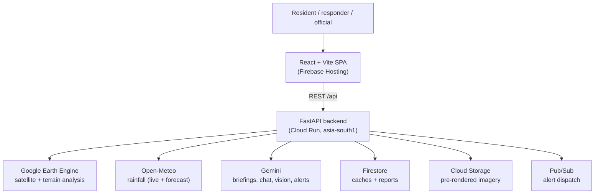

# ResQ Bharat — Documentation

**Live app:** https://resqbharat.web.app

ResQ Bharat is an AI-powered, satellite-grounded flood intelligence platform for
river basins across India. It fuses satellite radar, terrain, built-up surface,
cropland, population and live weather into flood-prone zone maps, a transparent
live flood-risk score, rainfall forecasts, floodplain-development monitoring,
agricultural crop-loss estimates, and a multilingual Gemini assistant — covering
**100 study areas across 28 states + 8 union territories**.

This documentation set is split into a **technical wiki** (for engineers,
reviewers and maintainers) and a **user guide** (for responders, officials and
residents using the app).

> **Scope note.** This documentation describes the system as implemented in this
> repository. Where a capability is cached, modelled, simulated, partially
> implemented, or planned, it is labelled as such. Risk scores are a transparent
> early-warning index, **not** a calibrated probability or an official forecast.

---

## Technical documentation

| Page | What it covers |
|---|---|
| [Architecture overview](technical/architecture-overview.md) | High-level system design and request flow |
| [System components](technical/system-components.md) | Frontend, backend, services and clients |
| [Data flow and pipelines](technical/data-flow-and-pipelines.md) | How a request becomes a rendered answer |
| [Flood-risk methodology](technical/flood-risk-methodology.md) | The exact risk formula and its inputs |
| [Geospatial and satellite data](technical/geospatial-and-satellite-data.md) | Earth Engine datasets and derivations |
| [Agriculture crop loss](technical/agriculture-crop-loss.md) | Crop-loss estimation model and assumptions |
| [Floodplain development](technical/floodplain-development.md) | Multi-signal construction change detection |
| [AI and Gemini integration](technical/ai-and-gemini-integration.md) | Gemini capabilities, grounding and safety |
| [API reference](technical/api-reference.md) | Every REST endpoint with request/response notes |
| [Data sources and provenance](technical/data-sources-and-provenance.md) | Source datasets, freshness and licensing notes |
| [Data models](technical/data-models.md) | Firestore documents and API payload shapes |
| [Deployment and infrastructure](technical/deployment-and-infrastructure.md) | Cloud Run, Hosting, Storage, Pub/Sub |
| [Configuration and environment](technical/configuration-and-environment.md) | Environment variables and settings |
| [Security and privacy](technical/security-and-privacy.md) | Data handling, secrets and threat notes |
| [Performance and reliability](technical/performance-and-reliability.md) | Caching, concurrency and fallbacks |
| [Testing and validation](technical/testing-and-validation.md) | Unit tests and SAR validation methodology |
| [Limitations and roadmap](technical/limitations-and-roadmap.md) | Known gaps and honest caveats |

## User guide

| Page | What it covers |
|---|---|
| [User guide home](user-guide/README.md) | Index and orientation for end users |
| [Getting started](user-guide/getting-started.md) | First visit and choosing an area |
| [Home dashboard](user-guide/home-dashboard.md) | Reading the landing page at a glance |
| [Flood intelligence](user-guide/flood-intelligence.md) | Zones, risk score and damage scenarios |
| [Location and map navigation](user-guide/location-and-map-navigation.md) | Finding and moving around areas |
| [Floodplain development](user-guide/floodplain-development.md) | Reading the construction-change view |
| [Agriculture crop loss](user-guide/agriculture-crop-loss.md) | Reading crop-loss estimates |
| [Reports and response](user-guide/reports-and-response.md) | Filing a citizen hazard report |
| [Gemini AI help](user-guide/gemini-ai-help.md) | Using the assistant and photo check |
| [Multilingual and voice](user-guide/multilingual-and-voice.md) | Languages, speech input and read-aloud |
| [Flood safety](user-guide/flood-safety.md) | Offline preparedness guidance |
| [Methodology and data quality](user-guide/methodology-and-data-quality.md) | What the numbers mean (and don't) |
| [Troubleshooting](user-guide/troubleshooting.md) | Common issues and fixes |
| [Frequently asked questions](user-guide/frequently-asked-questions.md) | Quick answers |

---

## System at a glance

## Quick links

- Source approach note (original Ganga design): [ganga-flood-approach.md](ganga-flood-approach.md)
- Project README: [../README.md](../README.md)
- Backend code: `backend/app/`
- Frontend code: `frontend/src/`

## Emergency reminder

ResQ Bharat is a decision-support and demonstration tool. Its outputs must be
validated before any operational use. In an emergency in India, call **112**.
