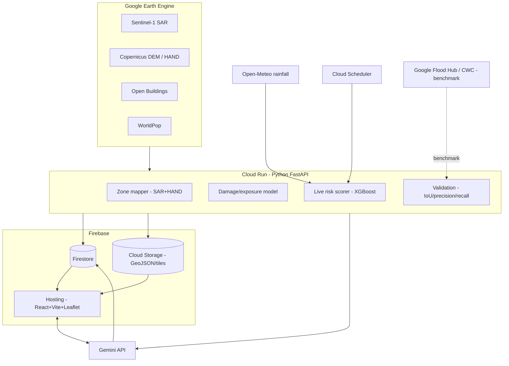

# Ganga Basin Flood Prediction & Risk Mapping — Detailed Approach

> Project for Google AI Builder Cup. Required stack: **Firebase, Firestore, Cloud Run, Gemini**.
> Goal: high-confidence flood-prone zone mapping + calibrated live flood risk + damage estimation for the Ganga river and its tributaries, visualized on a web map.

---

## 1. Basin overview & why it's a strong choice

The Ganga (Ganga) basin is India's largest and most flood-affected river system — ideal for impact storytelling and rich in public data.

**Geography (source → sea):**
- **Himalayan headwaters (snow/glacier fed, GLOF + flash-flood risk):** Bhagirathi (from Gangotri glacier) + Alaknanda → confluence at **Devprayag** → **Rishikesh → Haridwar** → enters plains.
- **Gangetic plains (slow, embankment-breach + backwater flooding):** Haridwar → Kanpur → Prayagraj (Yamuna confluence) → Varanasi → Patna → Bhagalpur → Farakka → Bangladesh.

**Major tributaries (flood relevance):**

| Tributary | Bank / origin | Flood relevance |
|---|---|---|
| **Kosi** | Left / Nepal Himalaya | "Sorrow of Bihar" — catastrophic avulsion & embankment breaches (2008). **Top priority zone.** |
| **Gandak** | Left / Nepal Himalaya | Severe Bihar flooding (Champaran, Gopalganj). |
| **Ghaghara (Karnali)** | Left / Nepal Himalaya | One of the most flood-prone; UP/Bihar. |
| **Yamuna** | Right / Yamunotri | Delhi + Prayagraj flooding. |
| **Ramganga, Gomti** | Left / Himalaya & plains | UP flooding. |
| **Son, Chambal, Betwa, Ken** | Right / peninsular | Flashier, dam-controlled. |
| **Bhagirathi/Alaknanda** | Himalayan source | GLOF & flash floods (Kedarnath 2013, Chamoli 2021). |

## 2. Recommended pilot scope (what to actually build in 10 days)

Build the full basin **architecture**, but run the live pipeline + validation on **two high-impact pilot stretches** so the demo is fast and the story is strong:

1. **Kosi river / North Bihar stretch** (around Supaul–Saharsa–Khagaria) — the "Sorrow of Bihar", embankment-breach flooding, dense population at risk. Headline zone.
2. **Patna Ganga main-stem stretch** (Danapur → Patna → Fatuha) — urban exposure, instantly recognizable, great for damage-estimation demo.

Optional stretch goal: **Alaknanda/Bhagirathi upstream** for the glacier/GLOF angle (ties in your "glacier data" input).

> You say on camera: "Demonstrated on the Kosi and Patna; the pipeline is basin-generic and scales to all Ganga tributaries."

## 3. Data sources (Ganga-specific)

| Need | Dataset / API | Access |
|---|---|---|
| Flood extent history | **Sentinel-1 SAR GRD** (2016–present) | Google Earth Engine (`COPERNICUS/S1_GRD`) |
| Optical land cover | **Sentinel-2 SR**, **Dynamic World** | Earth Engine |
| Terrain / flood physics | **Copernicus DEM GLO-30**, SRTM | Earth Engine (`COPERNICUS/DEM/GLO30`) |
| Permanent/seasonal water | **JRC Global Surface Water** | Earth Engine (`JRC/GSW1_4`) |
| Building footprints (damage) | **Google Open Buildings v3** | Earth Engine (`GOOGLE/Research/open-buildings/v3`) |
| Population exposure | **WorldPop / GHSL-POP** | Earth Engine |
| Rainfall (live + forecast) | **Open-Meteo** (free, no key), **NASA GPM IMERG** | REST API / Earth Engine |
| Snow / glacier state | **MODIS snow cover** (`MODIS/061/MOD10A1`), glacial lakes via S1/S2 | Earth Engine |
| River gauge / discharge | **CWC (Central Water Commission)** flood forecasts, **Google Flood Hub** | Web / API for benchmarking |
| Historical flood validation | **Global Flood Database (GFD)**, Sentinel-1 of known events | Earth Engine |

## 4. Flood-prone zone methodology (high confidence — headline feature)

Combine three **independent** signals; confidence = their agreement.

### 4.1 Observed flood frequency (strongest)
- For each monsoon 2016–2024, classify Sentinel-1 SAR water (VV/VH thresholding + Otsu, speckle filter).
- Per-pixel **flood frequency = (# years flooded) / (# years observed)**.
- High frequency → high confidence flood-prone.

### 4.2 Hydrological terrain (physics)
From Copernicus DEM:
- **HAND (Height Above Nearest Drainage)** — low HAND = physically floodable.
- Slope, flow accumulation, distance-to-channel.
- Produces a floodable mask even where SAR had cloud/timing gaps.

### 4.3 Permanent-water & channel context
- JRC GSW for channel migration, seasonal water, and to exclude permanent river.

### 4.4 Confidence score
```
zone_confidence = w1 * observed_frequency
               + w2 * hand_floodability
               + w3 * jrc_seasonality
```
Only label "HIGH confidence flood-prone" where **observed_frequency AND low-HAND agree**. Display 0–100% on the map.

### 4.5 Validation (this is your proof)
- Map the **2008 Kosi breach** and a recent event (e.g. 2019/2020 Bihar floods) extent from Sentinel-1.
- Overlay predicted zones vs actual extent → report **precision, recall, IoU**.
- Cross-check against **Google Flood Hub** inundation maps for the same reach.

## 5. Live flood risk (calibrated, honest "prediction")

Not a black-box forecast — a **calibrated risk score validated on history**.

**Features per zone:**
- Open-Meteo rainfall: next 1–7 day forecast + last 3-day cumulative (local + upstream basin).
- Upstream snow/glacial state (MODIS), for Himalayan tributaries.
- Static flood-proneness from §4.
- Antecedent soil-moisture proxy (recent rain accumulation).
- Gauge/discharge trend from CWC where available.

**Model:**
- Labels = "did SAR show flooding in this zone within N days" from the 2016–2024 archive.
- Train **XGBoost / logistic regression** → probability per zone.
- **Calibrate** with Platt/isotonic scaling; report **Brier score** + calibration curve.
- Update on a schedule (Cloud Scheduler → Cloud Run) so the demo is "live".

## 6. Damage & life-loss estimation (your unique angle)

For each flood-prone zone at a given flood intensity/depth:

1. **Buildings exposed** = Google Open Buildings footprints ∩ flood zone at depth d (depth from DEM + flood stage).
2. **Population exposed** = WorldPop/GHSL within zone.
3. **Monetary damage** = Σ (building_area × construction_cost_per_m² × depth_damage_factor(d)).
   - Depth-damage curves from published flood-loss literature (label clearly as estimates).
4. **Life-risk index** = population_exposed × vulnerability (warning time, flood velocity for flash floods).
5. Output per intensity scenario (e.g. "1-in-10", "1-in-25", "1-in-100 year" flood).

> Always label these as **transparent estimates** from published depth-damage curves, not guarantees.

## 7. Architecture & tech mapping



- **Cloud Run:** Python 3.11 + FastAPI + `earthengine-api`, `xgboost`, `rasterio`, `geopandas`.
- **Firestore:** zones, building-risk aggregates, live risk docs, Gemini briefings, validation metrics.
- **Cloud Storage:** GeoJSON flood zones + precomputed map tiles (don't stream raw EE to users).
- **Firebase Hosting:** React + Vite + Leaflet map UI.
- **Gemini:** plain-language risk briefings, damage narratives, "ask this zone" chat, what-if scenarios.
- **Cloud Scheduler:** periodic live-risk refresh.

## 8. Firestore data model (draft)

```
basins/{basinId}                      # e.g. "ganga"
  tributaries/{tribId}                # "kosi", "gandak", "ganga_main"
    zones/{zoneId}
      - geometry: GeoJSON (or Cloud Storage ref)
      - confidence: 0-100
      - flood_frequency: 0-1
      - hand_m: number
      - buildings_exposed: int
      - population_exposed: int
      - est_damage_inr: number
      - scenarios: { "1in10": {...}, "1in25": {...}, "1in100": {...} }
    live_risk/{zoneId}
      - probability: 0-1
      - level: "low|medium|high|severe"
      - rainfall_mm_7d: number
      - updated_at: timestamp
      - brier_score: number
    briefings/{briefingId}            # Gemini-generated
      - zone_ref, text, created_at
validation/{eventId}                  # "kosi_2008", "bihar_2019"
  - precision, recall, iou, notes
```

## 9. Backend API (FastAPI endpoints)

| Endpoint | Purpose |
|---|---|
| `POST /zones/compute` | Run SAR+HAND zone mapping for a tributary, write to Firestore/Storage |
| `GET /zones?trib=kosi` | Return flood-prone zones + confidence |
| `POST /damage/estimate` | Buildings/pop/₹ damage for a zone at depth/scenario |
| `POST /risk/refresh` | Recompute live risk (called by Cloud Scheduler) |
| `GET /risk?trib=kosi` | Current live risk per zone |
| `POST /validate` | Compute precision/recall/IoU vs a known event |
| `POST /ai/briefing` | Gemini risk briefing for a zone |
| `POST /ai/chat` | Gemini Q&A / what-if on a zone |

## 10. Gemini integration (your AI showcase)

- **Risk briefing:** feed zone metrics → "Kosi Zone 4 (Supaul): HIGH risk, ~1,200 buildings & ~6,500 people exposed, est. ₹X cr damage at 1-in-25 flood. Rainfall forecast 180 mm/72h upstream."
- **What-if chat:** "What if upstream rain doubles?" → Gemini reasons over the model outputs.
- **Multimodal (stretch):** pass before/after SAR thumbnails to Gemini for a visual change description.
- **Grounding:** always feed Gemini the *computed numbers*; never let it invent figures.

## 11. Confidence metrics to display (what "high confidence" means to judges)

- Flood-prone zones: **IoU / precision / recall** vs 2008 Kosi + recent Bihar floods.
- Live risk: **Brier score** + calibration curve.
- **Agreement %** with Google Flood Hub for the same reach.
- Show these as a "Model Confidence" panel in the UI.

## 12. 10-day execution timeline

| Day | Deliverable |
|---|---|
| 1 | EE + GCP + Firebase setup; verify EE access; repo scaffold. |
| 2 | Sentinel-1 water classification for Kosi; flood-frequency layer. |
| 3 | HAND + terrain; combine into confidence score; export GeoJSON. |
| 4 | Validation module vs 2008 Kosi / 2019 Bihar → IoU/precision/recall. |
| 5 | Open Buildings + WorldPop overlay → damage/exposure model. |
| 6 | Open-Meteo live risk scorer (rule-based first, then XGBoost). |
| 7 | React + Leaflet frontend: zones, buildings, confidence, live risk. |
| 8 | Gemini briefing + chat; Firestore wiring; Cloud Scheduler. |
| 9 | Deploy Cloud Run + Firebase Hosting; end-to-end polish. |
| 10 | Record 3–4 min video; write Brief description; final checks. |

## 13. Risk callouts / honesty

- Zone mapping = **genuinely high confidence** (observed history). Make it the headline.
- Live next-day prediction = **calibrated early-warning**, not a guaranteed forecast. Don't overclaim.
- Damage ₹ = **transparent estimates** from published depth-damage curves.
- Keep Cloud Run min-instances = 0; set a GCP budget alert to stay free.

---
*Next step: set up Earth Engine + GCP, then scaffold the Cloud Run backend + React/Firebase frontend from this blueprint.*
