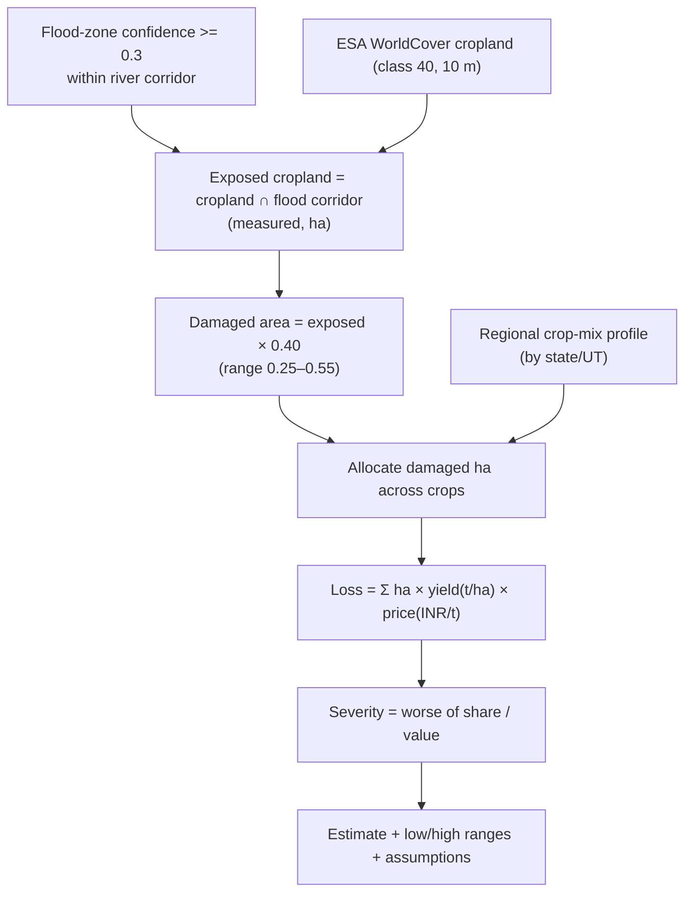

# Agriculture Crop Loss

Implemented in `backend/app/services/agri_loss.py`. This feature estimates
flood-related agricultural loss for a study area: how much cropland is exposed,
how much is estimated damaged, and an indicative monetary value in Indian Rupees.

> **Credibility first.** The **exposed cropland area is a satellite measurement**.
> The **damaged area and monetary loss are documented assumptions**, not a
> government damage survey. Every figure carries provenance and a confidence
> label, and the pure-Python helpers are unit-testable without Earth Engine.

## Pipeline



## Model parameters

| Parameter | Value | Nature |
|---|---|---|
| Flood confidence threshold | 0.30 | Matches `damage.py` exposure threshold |
| Damage fraction (central) | 0.40 | Documented assumption |
| Damage fraction (low / high) | 0.25 / 0.55 | Uncertainty band |

Exposure is **not** destruction: shallow or short-duration inundation, bunded
fields, drainage and crop stage mean only a portion of exposed crops are lost.
The 0.40 central value and its band are surfaced in the API so the estimate is
never presented as exact.

## Crop reference (indicative national averages)

The code holds coarse national-average yield (t/ha) and farm-gate/MSP-indicative
price (INR/t) assumptions for nine crops (rice, wheat, maize, sugarcane, cotton,
pulses, oilseeds, millets, jute). These are drawn from public agricultural
statistics (Agricultural Statistics at a Glance / CACP MSP, indicative 2023–24
levels). They are **assumptions for estimation, not per-field data**, kept in one
place so they can be refined.

## Regional cropping mix

Damaged hectares are allocated across crops using a per-state/UT dominant
cropping pattern (`REGION_CROP_PROFILE`), with a default profile
(rice/wheat/pulses/oilseeds) for unlisted regions. This is a **documented
regional assumption** about typical cropping mix, not a measured per-location
crop map.

## Monetary valuation

For each crop:

```
loss_inr = damaged_area_crop(ha) × yield(t/ha) × price(INR/t)
```

The damage fraction is already baked into `damaged_area_ha`, so it is **not**
applied again (no double counting). Low/high loss ranges scale by the damage
fraction band.

## Severity

Loss is classified on two independent axes and the **worse** of the two is taken,
with the basis made explicit:

- **Share** = damaged cropland / total AOI cropland (severe ≥ 0.30, high ≥ 0.15,
  moderate ≥ 0.05, else low)
- **Value** = estimated monetary loss (severe ≥ ₹50 cr, high ≥ ₹10 cr,
  moderate ≥ ₹1 cr, else low)

This avoids a large-but-low-value area or a small-but-high-value area being
mislabelled.

## Data confidence label

Each estimate is labelled by the area's coverage tier:

- `estimated (SAR-validated flood extent)` when coverage is `live`
- `estimated (modelled flood extent)` otherwise

## Portfolio rollup

`/api/agri-loss-summary` aggregates only **cached** per-area results (never
triggers a fresh Earth Engine run) so the dashboard is fast. Areas not yet
computed are reported as pending rather than fabricated. Per-area results are
cached in Firestore (`pilots/{id}/cache/agri_loss`).

## Disclaimer (as returned by the API)

> Model-generated estimate. Flood-exposed cropland is derived from satellite land
> cover intersected with a modelled flood extent; damaged area and monetary loss
> apply documented damage-fraction, yield and price assumptions allocated by a
> coarse regional cropping pattern. These figures are indicative only and are NOT
> a substitute for official agricultural damage surveys or government compensation
> assessments.
