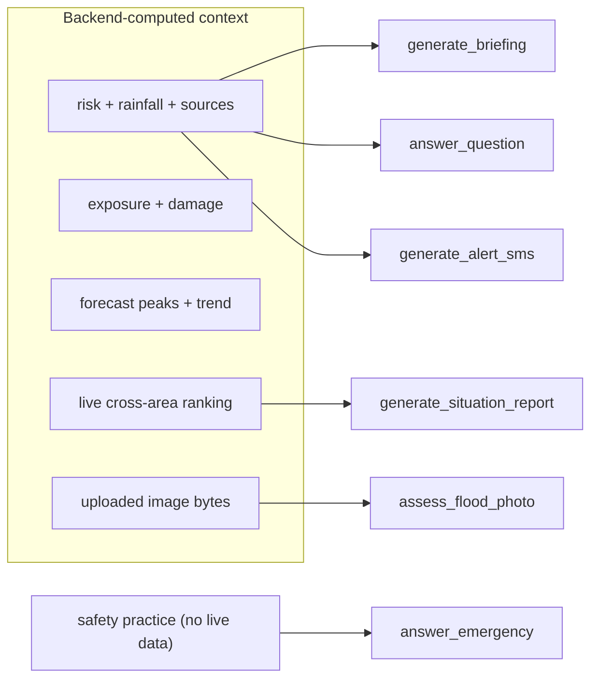

# AI and Gemini Integration

All generative-AI features use Google Gemini via the `google-genai` SDK,
implemented in `backend/app/clients/gemini_client.py`. Every capability is
**grounded strictly on numbers the backend computes** and is prompted not to
invent live measurements, facilities, or contact details.

## Model selection and fallback

The client tries a primary model and falls back to older flash tiers if one is
overloaded (503) or unavailable (404), keeping responses available during spikes:

```
gemini-3.8-flash → gemini-3.7-flash → gemini-3.6-flash → gemini-3.5-flash → gemini-flash-latest
```

Both text (`_generate`) and multimodal (`_generate_parts`) paths iterate this
chain and only error if every model fails.

## Capabilities

| Function | Endpoint | Purpose |
|---|---|---|
| `generate_briefing` | `POST /api/ai/briefing` | One-paragraph operational risk briefing |
| `answer_question` | `POST /api/ai/chat` | Grounded what-if / explanatory Q&A for an area |
| `generate_alert_sms` | `POST /api/ai/alert` | Short citizen alert (SMS/WhatsApp copy) |
| `answer_emergency` | `POST /api/ai/assist` | Public, location-aware flood-safety assistant |
| `generate_situation_report` | `POST /api/ai/situation` | Control-room SITREP from the live ranking |
| `assess_flood_photo` | `POST /api/ai/photo` | **Multimodal** vision hazard assessment of a user photo |



## Grounding and safety rules (enforced in prompts)

- Reason only about the **selected area and river system** given in the context;
  never assume a northern river.
- The `risk` object is a **modelled** estimate, not a measured gauge reading;
  state its freshness from `risk.updated_at`.
- If `data_quality.rainfall_complete` is false, warn the score may be understated.
- Respect the `coverage` tier (`modelled`/`partial` = not yet validated there).
- **Never** invent live measurements, river gauge levels, active alerts,
  evacuation orders, shelter/hospital names or capacities, road conditions,
  distances, or phone numbers.
- For immediate-threat situations, lead with an urgent line to call **112** and
  only cite well-known official Indian emergency numbers (112, 100, 101, 102/108,
  1070, 1077, 1091, 1098).
- Never advise walking/swimming/driving through floodwater; never claim rescue
  has been dispatched or a location shared.

## Situation report

`generate_situation_report` synthesises the live cross-area ranking (the same
numbers the UI shows) into a decision-ready SITREP: headline (how many areas
under high/severe alert out of how many assessed), priority areas, where to
focus, and data-freshness caveats. It adds **interpretation and prioritisation,
not new facts**, and is capped under 180 words. The endpoint reuses the cached
ranking and counts high/severe areas before calling Gemini.

## Multimodal photo assessment (vision)

`assess_flood_photo` sends the uploaded image to Gemini via
`types.Part.from_bytes(data, mime_type)`. The prompt (`_PHOTO_SYSTEM`) requires:

- Assess **only what is visibly evident**; depth only in qualitative,
  reference-based terms — never a precise cm/m figure (depth cannot be measured
  from a photo).
- Flag visible hazards: current/flow, submerged obstacles, proximity to
  electrical lines, open drains/manholes, contamination, unstable structures.
- Never invent a location, facility, road, distance, or phone number.
- If the photo does not show flooding or is unclear, say so and give general
  preparedness advice instead of guessing.

The `/api/ai/photo` endpoint validates the upload server-side: MIME must be one
of `image/jpeg`, `image/png`, `image/webp`, `image/heic` (415 otherwise), the
body must be non-empty (400) and at most 8 MB (413); a vision failure returns 502.

## Languages

The client supports ten UI languages (en, hi, bn, mr, te, ta, gu, kn, ml, pa)
plus retained regional varieties (bho, mai) for backward compatibility. Any
BCP 47 tag the frontend sends (e.g. `hi-IN`) is normalised to a short subtag, and
a language clause instructs Gemini to write the entire response in that language
with Arabic numerals. See [Multilingual and voice](../user-guide/multilingual-and-voice.md).

## Configuration

Gemini requires `GEMINI_API_KEY` in the environment/`.env`. The client raises a
clear error if the key is missing. The key is **never** logged or returned in any
response. See [Configuration and environment](configuration-and-environment.md).
