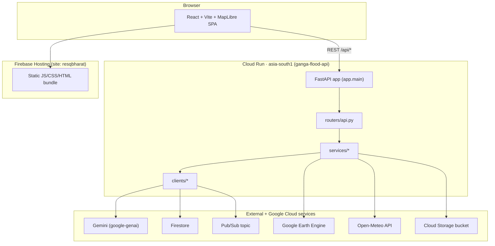
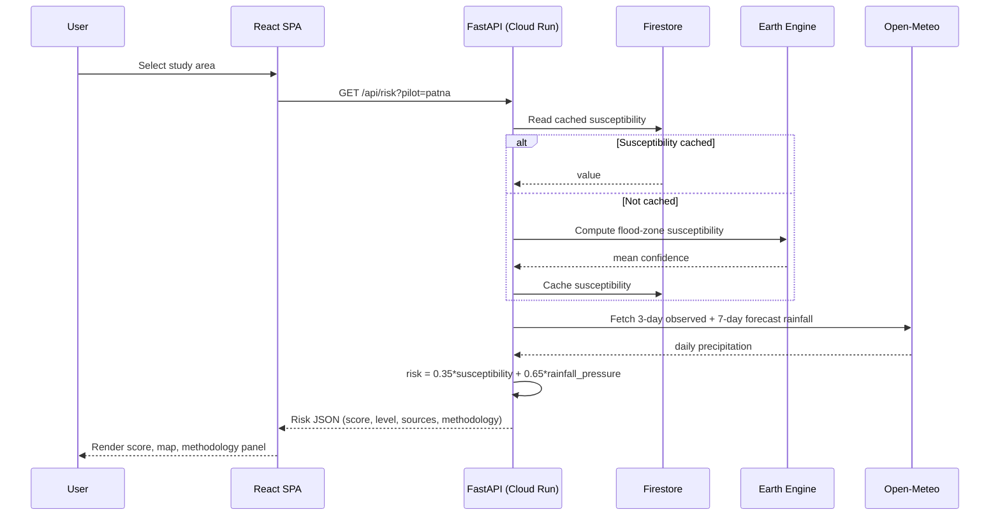
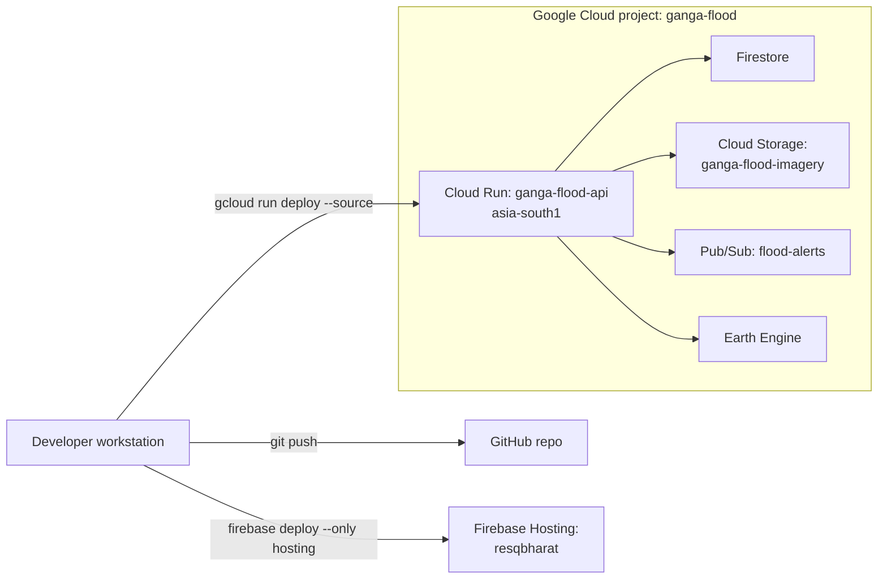

# Architecture Overview

ResQ Bharat is a two-tier web application: a React single-page app (SPA) served
as static files, talking over REST to a stateless FastAPI backend. The backend
orchestrates Google Earth Engine, Open-Meteo, Gemini, Firestore, Cloud Storage
and Pub/Sub. There is no self-hosted database or GIS stack — all geospatial
computation runs server-side in Earth Engine, and durable state lives in managed
Google Cloud services.

## Design goals

- **Satellite-grounded, honest outputs.** Every figure carries provenance and a
  coverage/confidence label; the code never fabricates gauge readings or alerts.
- **Fast after warm-up.** Expensive Earth Engine passes are cached in Firestore
  (cross-instance) and accelerated per-instance with short-TTL in-process caches.
- **Stateless backend.** Any Cloud Run instance can serve any request; shared
  state is in Firestore and Cloud Storage.
- **Graceful degradation.** Missing rainfall days, absent imagery, Pub/Sub
  failures and overloaded Gemini models all degrade honestly instead of breaking.

## High-level architecture

## End-to-end request flow

A typical "show me the risk for this area" interaction:

## Layered responsibilities

| Layer | Location | Responsibility |
|---|---|---|
| Presentation | `frontend/src/pages`, `frontend/src/components` | Rendering, map, charts, forms, i18n |
| API client | `frontend/src/api.ts` | Typed fetch wrappers, timeouts, GET de-duplication |
| HTTP routing | `backend/app/routers/api.py` | Endpoint definitions, request validation, caching policy |
| Domain services | `backend/app/services/*` | Risk, forecast, zones, damage, crop loss, imagery, validation |
| Integration clients | `backend/app/clients/*` | Firestore, Gemini, Pub/Sub, Cloud Storage |
| Area registry | `backend/app/basins.py` | 100 study areas, regions, coverage tiers, validation metrics |
| Config | `backend/app/config.py` | Environment-driven settings |

See [System components](system-components.md) for a component-level breakdown and
[Data flow and pipelines](data-flow-and-pipelines.md) for the per-feature pipelines.

## Deployment topology

Deployment specifics (regions, service accounts, commands) are in
[Deployment and infrastructure](deployment-and-infrastructure.md).

## Key non-functional properties

- **Statelessness & caching:** [Performance and reliability](performance-and-reliability.md)
- **Secrets & data handling:** [Security and privacy](security-and-privacy.md)
- **Honest coverage tiers:** [Flood-risk methodology](flood-risk-methodology.md)
