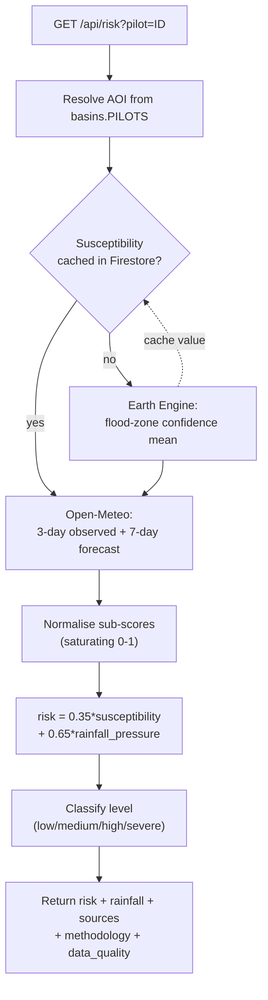
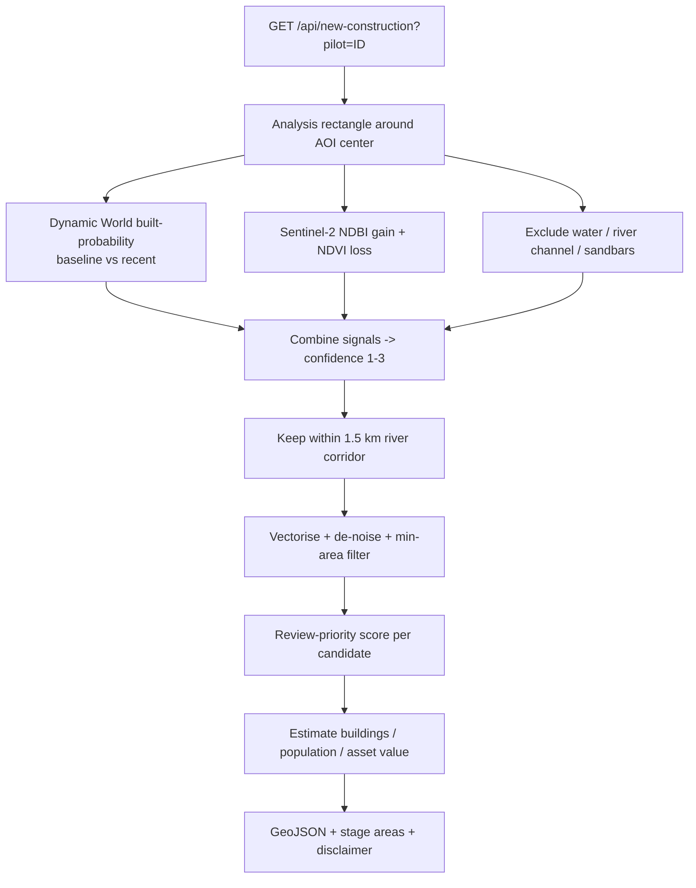
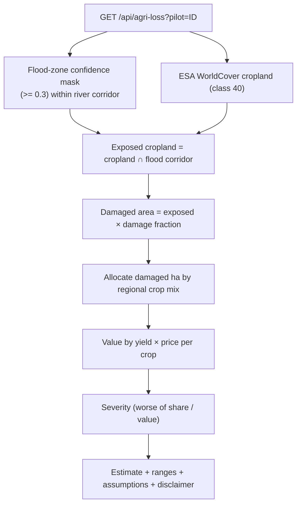
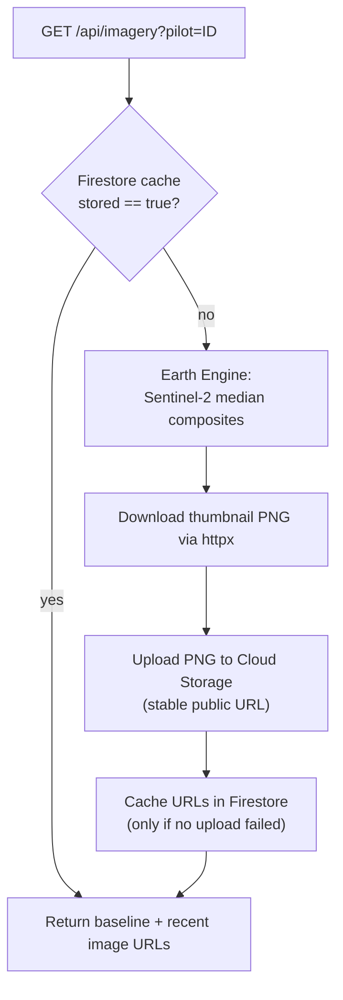
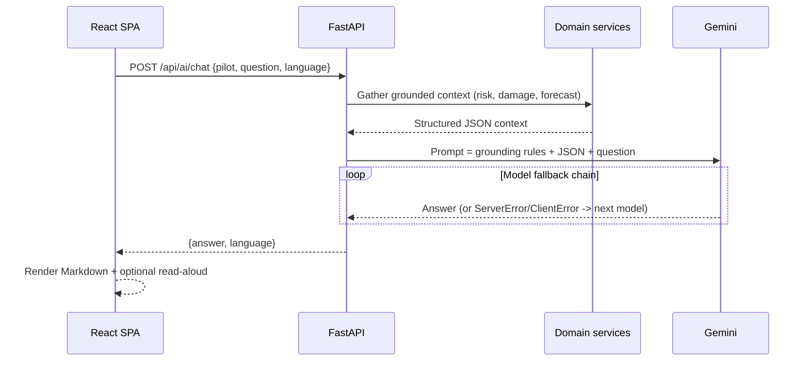
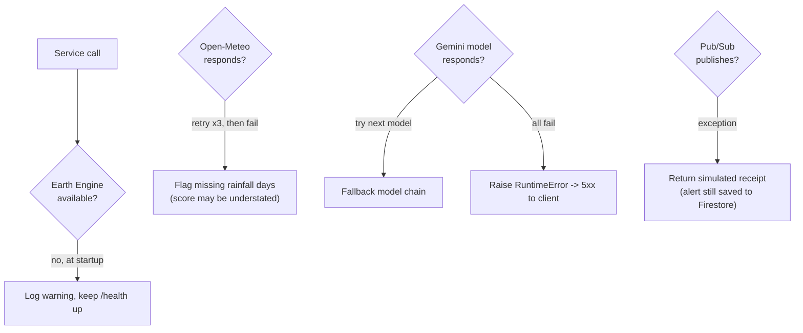

# Data Flow and Pipelines

This page describes how each major feature turns raw data into a rendered answer.
All pipelines share two principles: **cache the expensive parts** and **degrade
honestly** when data is missing.

## Flood-risk pipeline

The live risk score blends static terrain susceptibility (Earth Engine) with
live rainfall pressure (Open-Meteo).

Normalisation and weights are fixed and published verbatim in the API response
(`methodology`): see [Flood-risk methodology](flood-risk-methodology.md).

The cross-area ranking (`/api/top-risk`, `/api/alerts`) runs `compute_live_risk`
for every area concurrently (bounded thread pool, 12 workers), skips any area
that fails (never zeroing it), and reports `assessed` vs `total`. The ranking is
cached in Firestore with a stale-while-revalidate, single-flight refresh policy
(see [Performance and reliability](performance-and-reliability.md)).

## Satellite change-detection pipeline (floodplain development)

Details and thresholds: [Floodplain development](floodplain-development.md).
Results are cached in Firestore per area (`pilots/{id}/cache/new_construction`).

## Crop-loss pipeline

Exposed cropland is a satellite measurement; damaged area and monetary loss are
documented **assumptions**. See [Agriculture crop loss](agriculture-crop-loss.md).

## Before/after imagery pipeline (Cloud Storage cache)

Rendering once to Cloud Storage turns a multi-second Earth Engine recompute into
a sub-200ms cached response and avoids expired thumbnail URLs. Pass `refresh=true`
to force a re-render. Honest `available: false` is preserved when a window has no
usable scenes.

## Gemini request/response sequence

Gemini only ever receives numbers computed by the backend; it is instructed not
to invent live measurements, facilities, or contact details. See
[AI and Gemini integration](ai-and-gemini-integration.md).

## Failure / fallback workflow

Specific fallbacks:

- **Earth Engine init failure** at startup is logged but non-fatal so `/health`
  stays reachable.
- **Open-Meteo** requests retry up to 3 times; missing days are flagged via
  `data_quality.rainfall_complete` rather than silently treated as zero.
- **Gemini** iterates a model fallback chain; only if every model fails does the
  request error.
- **Pub/Sub** publish failures return a simulated dispatch receipt; the alert is
  still generated and recorded in Firestore.
- **Firestore cache writes** are best-effort and wrapped in try/except so a cache
  failure never fails the request.
