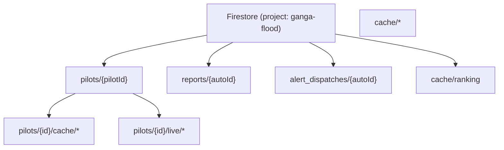

# Data Models

ResQ Bharat has no relational database. Durable state lives in **Firestore**
(document cache + citizen reports) and **Cloud Storage** (pre-rendered imagery).
API payload shapes are typed in `frontend/src/types.ts`.

## Firestore layout



### Per-area cache documents

| Path | Written by | Contents |
|---|---|---|
| `pilots/{id}/cache/susceptibility` | `live_risk.susceptibility_for` | `{ value }` |
| `pilots/{id}/cache/zones` | `/api/zones` | `{ geojson }` |
| `pilots/{id}/cache/new_construction` | `/api/new-construction` | Full construction result |
| `pilots/{id}/cache/agri_loss` | `/api/agri-loss` | Full crop-loss result |
| `pilots/{id}/cache/imagery` | `imagery.compute_imagery` | Imagery URLs + `stored` flag |
| `pilots/{id}/live/risk` | `/api/risk` | Last computed live risk |
| `pilots/{id}/live/briefing` | `/api/ai/briefing` | `{ text }` |

### Global documents

| Path | Written by | Contents |
|---|---|---|
| `cache/ranking` | `_recompute_ranking` | `top`, `all`, `assessed`, `total`, `generated_at` |
| `reports/{autoId}` | `POST /api/reports` | Citizen hazard report (below) |
| `alert_dispatches/{autoId}` | `POST /api/ai/alert` | Alert event + dispatch receipt |

### Citizen report document

```jsonc
{
  "pilot": "patna | null",
  "location": "string (1–120)",
  "hazard_type": "string (1–60)",
  "severity": "string (1–20)",
  "description": "string (<=1000)",
  "reporter_name": "string (<=80)",
  "contact": "string (<=120)",
  "lat": 25.6, "lon": 85.1,
  "status": "reported",
  "created_at": "ISO-8601"
}
```

## Cloud Storage layout

Bucket `ganga-flood-imagery` (public read). Objects:

```
imagery/{pilotId}/baseline.png
imagery/{pilotId}/recent.png
```

Each PNG is served from a stable public URL
`https://storage.googleapis.com/ganga-flood-imagery/<path>` with
`Cache-Control: public, max-age=86400`.

## Key API payload shapes

Mirrored in `frontend/src/types.ts`. Selected shapes:

- **Pilot** — `id`, `name`, `tributary`, `basin?`, `region?`, `coverage?`,
  `bbox`, `center`.
- **Risk** — `probability`, `level`, `susceptibility`, `rainfall`, `model`,
  `updated_at?`, `sources?`, `methodology?`, `data_quality?`.
- **Forecast** — `series[]`, `horizons[]?`, `peak_72h`, `peak_7d`, `trend`.
- **Damage** — `buildings_exposed`, `population_exposed`, `scenarios{}`.
- **NewConstruction** — estimates + `stages[]`, `candidate_count`, `priority?`,
  `geojson`, `disclaimer`.
- **AgriLoss** — measured + estimated areas, loss + ranges, `crops[]`,
  `severity`, `sources`, `methodology`, `disclaimer`.
- **Imagery** — `baseline`/`recent` sides with `available`, `url`, `scenes`.
- **SituationReport** — `language`, `generated_at`, `assessed`, `total`,
  `high_or_severe_count`, `report`.
- **PhotoAssessment** — `language`, `location`, `question`, `assessment`.
- **ZonesGeoJSON** / **ConstructionGeoJSON** — GeoJSON `FeatureCollection<Polygon>`
  with typed properties.

## Coverage & validation (in-code registry)

`backend/app/basins.py` is the authoritative registry: `PILOTS` (100 areas),
`PILOT_REGION` (state/UT per area), `RIVER_BASIN` (basin grouping),
`VALIDATION_METRICS` (real SAR precision/recall/IoU per validated area), and the
`_LIVE_COVERAGE` / `_PARTIAL_COVERAGE` sets that decide the coverage tier. This is
code, not a database table, so it is version-controlled and reviewable.
