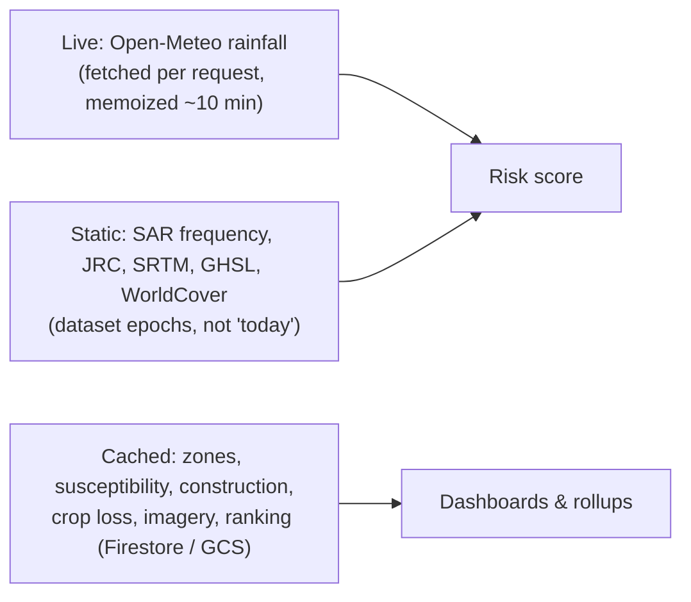

# Data Sources and Provenance

ResQ Bharat derives everything from public satellite products, a free weather API,
and documented economic assumptions. No proprietary or private datasets are used.
Provenance is surfaced in API responses so the UI can show what each layer is —
and is not.

## External data sources

| Source | Type | Temporal | Role |
|---|---|---|---|
| Open-Meteo | Weather API | 3-day observed + 7-day forecast, fetched on request | Rainfall pressure, forecast |
| Sentinel-1 SAR (`COPERNICUS/S1_GRD`) | Satellite radar | Monsoon scenes 2019–2024 | Observed flood frequency; validation |
| JRC Global Surface Water v1.4 | Satellite-derived | 1984–2021 | Seasonal/permanent water, channel |
| SRTM 30 m (`USGS/SRTMGL1_003`) | Elevation | 2000 survey | Terrain / height-above-drainage |
| Sentinel-2 Harmonized | Optical | ~2016 baseline + 2026 recent windows | Imagery; NDBI/NDVI change |
| Dynamic World | Land cover (ML) | Baseline vs recent | Built-up probability change |
| GHSL built-up surface | Built-up (2020) | 2020 | Building exposure |
| WorldPop | Population | Latest available for IND | Population exposure |
| ESA WorldCover v200 | Land cover | 2021, 10 m | Cropland extent |

## Economic assumptions (clearly flagged)

- **Depth-damage factors** (0.20 / 0.40 / 0.65 for 1-in-10/25/100) from published
  flood-loss literature.
- **Replacement cost** ₹15,000/m²; **typical footprint** 70 m².
- **Crop yield / price** indicative national averages (Agricultural Statistics at
  a Glance / CACP MSP, 2023–24 levels).
- **Regional cropping mix** per state/UT — a documented assumption, not a measured
  crop map.

These are **assumptions for estimation**, labelled as such wherever they appear.

## Provenance surfaced in responses

- `/api/risk` returns a `sources` array (Open-Meteo, JRC GSW, Sentinel-1, SRTM)
  with `kind` (forecast / historical / observed / static) and `temporal` ranges,
  plus a `methodology` block and `data_quality` freshness.
- `/api/agri-loss` returns an `AGRI_SOURCES` array distinguishing satellite
  measurement from economic assumption, plus a `methodology` block.
- Each area carries a `coverage` tier and (where validated) real SAR `validation`
  metrics.

## Freshness and caching

- Only rainfall is live; it keeps its true upstream `fetched_at`.
- Historical and terrain layers are **static dataset epochs**, not observations of
  the current day.
- Heavy outputs are cached; the UI shows cached values with their generation time.

## Licensing notes

Satellite datasets are accessed through Google Earth Engine under its terms;
Open-Meteo is a free API. This repository does not redistribute the underlying
datasets — it computes derived metrics on demand. Consult each provider's terms
before any commercial or operational use.

## What is never a source

The system does **not** use, and must never fabricate: live river-gauge readings,
official government alerts or evacuation orders, shelter/hospital directories, or
phone numbers beyond well-known national emergency lines. See
[Security and privacy](security-and-privacy.md) and
[AI and Gemini integration](ai-and-gemini-integration.md).
