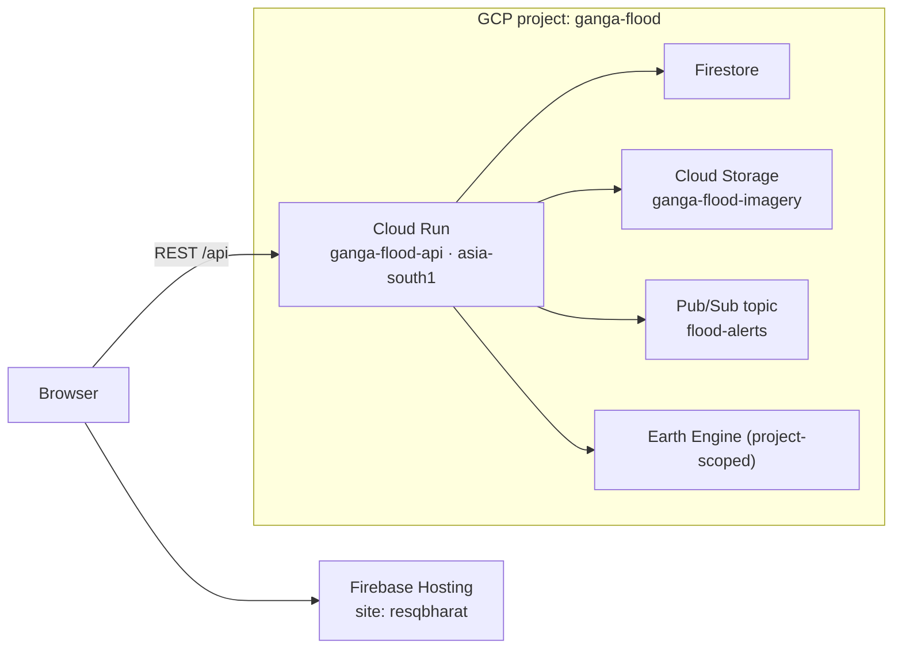
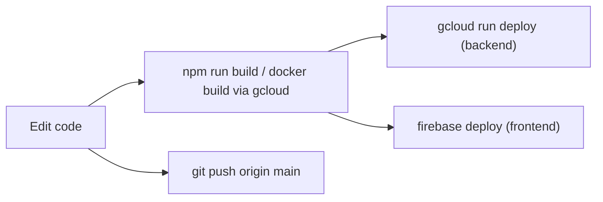

# Deployment and Infrastructure

ResQ Bharat runs entirely on managed Google Cloud services in the
`ganga-flood` project. There are two deploy targets: the backend (Cloud Run) and
the frontend (Firebase Hosting).

## Topology



## Backend — Cloud Run

- **Service:** `ganga-flood-api`, region `asia-south1`.
- **Container:** `backend/Dockerfile` — Python 3.12 slim, installs
  `requirements.txt`, runs `uvicorn app.main:app` on `$PORT` (8080).
- **Deploy from source** (from the `backend` directory):

  ```powershell
  gcloud run deploy ganga-flood-api --source . --region asia-south1 --project ganga-flood --quiet
  ```

- Earth Engine and Firestore use the service account attached to the Cloud Run
  service (Application Default Credentials on the platform).

## Frontend — Firebase Hosting

- **Site:** `resqbharat` (`firebase.json`), serving `frontend/dist`.
- SPA rewrite: all paths → `/index.html`. Long-lived immutable cache headers on
  hashed JS/CSS.
- **Build and deploy:**

  ```powershell
  cd frontend
  npm install
  npm run build
  firebase deploy --only hosting --project ganga-flood
  ```

> A `npm run build` that prints "✓ built in Xs" is successful even if the shell
> reports a non-zero code — that is a chunk-size warning on stderr, not a failure.

## Cloud Storage

Bucket `ganga-flood-imagery` stores pre-rendered before/after composites with
public read so the browser can load them directly. The backend service account
needs object write; see [Data models](data-models.md) for object paths. The bucket
uses uniform bucket-level access.

## Pub/Sub

Topic `flood-alerts` receives citizen alert dispatches from `POST /api/ai/alert`.
Publishing is best-effort: if the topic or permissions are unavailable, the alert
is still generated and stored in Firestore and a simulated receipt is returned. A
downstream subscriber (e.g. an SMS/WhatsApp gateway) can consume the topic.

## Earth Engine

Initialised per instance against the configured GCP project. Startup failure is
logged but non-fatal so `/health` stays reachable for debugging.

## CORS

Allowed origins come from the `CORS_ORIGINS` setting (comma-separated), defaulting
to local dev URLs. Production must include the Hosting origin. See
[Configuration and environment](configuration-and-environment.md).

## Release flow



> This page documents the deploy **commands and targets present in the repo**. It
> does not assert specific IAM role bindings, quotas, or billing configuration —
> verify those in the Cloud console for your environment.
