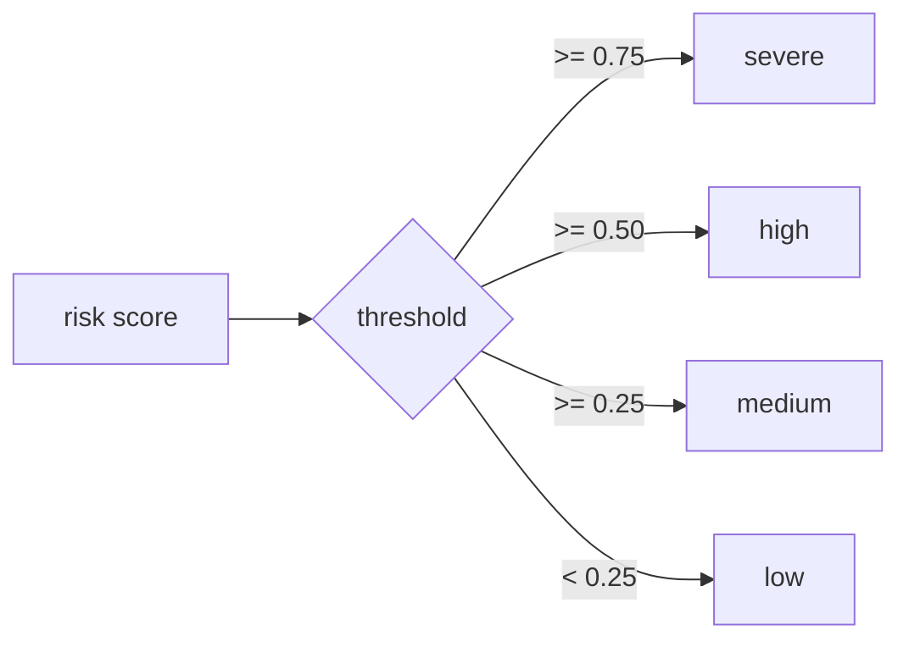

# Flood-Risk Methodology

The live flood-risk score is a **transparent, relative early-warning index on a
0–1 scale — not a calibrated flood probability or an official forecast.** This
page documents the exact formula as implemented in
`backend/app/services/live_risk.py`. The same values are published verbatim in
every `/api/risk` response under `methodology`, so the UI and this document share
one source of truth.

## The formula

```
risk = 0.35 × susceptibility + 0.65 × rainfall_pressure
```

where

```
rainfall_pressure = 0.4 × antecedent(3-day) + 0.6 × forecast(7-day)
```

Each rainfall term is normalised to a saturating 0–1 scale:

```
antecedent = min(antecedent_3d_mm / 150, 1.0)
forecast   = min(forecast_7d_mm   / 250, 1.0)
```

The final score is clamped to `[0, 1]`.

### Constants (single source of truth)

| Constant | Value | Meaning |
|---|---|---|
| `SUSCEPTIBILITY_WEIGHT` | 0.35 | Weight of static terrain susceptibility |
| `RAINFALL_WEIGHT` | 0.65 | Weight of rainfall pressure |
| `ANTECEDENT_SATURATION` | 150 mm | 3-day rain that saturates the antecedent sub-score |
| `FORECAST_SATURATION` | 250 mm | 7-day rain that saturates the forecast sub-score |

Antecedent/forecast internal split is `0.4 / 0.6` inside `rainfall_pressure`.

## Inputs

### Susceptibility (static)

Terrain- and history-derived flood susceptibility, computed once per area in
Earth Engine and cached in Firestore (`pilots/{id}/cache/susceptibility`). It is
the mean confidence of the flood-zone image, which combines:

- **Sentinel-1 SAR** observed flood frequency across past monsoons (weight 0.55)
- **JRC Global Surface Water** seasonal occurrence (weight 0.20)
- **SRTM** low-lying / height-above-drainage proxy (weight 0.25)

Permanent open water is excluded so the score represents floodable **land**. See
[Geospatial and satellite data](geospatial-and-satellite-data.md).

### Rainfall pressure (live)

Fetched per request from Open-Meteo for the area centroid: 3 days of observed
rainfall plus a 7-day forecast. Missing days are tracked explicitly — if any
expected day is absent, `data_quality.rainfall_complete` is `false` and the score
may be **understated** (missing days are not silently treated as zero).

## Risk levels



| Level | Score range |
|---|---|
| severe | ≥ 0.75 |
| high | ≥ 0.50 and < 0.75 |
| medium | ≥ 0.25 and < 0.50 |
| low | < 0.25 |

An area is considered "under alert" (surfaced in `/api/alerts`) when its level is
`high` or `severe`.

## Forecast trajectory

`/api/forecast` projects the score forward day-by-day using the Open-Meteo daily
forecast, plus short 6h/24h/72h windows from the hourly feed. The daily series
combines a 3-day trailing wetness proxy with each day's rainfall, weighted by the
same susceptibility. It reports the 72-hour and 7-day peak and a trend
(`rising`/`falling`/`steady`). This is the predictive layer on top of the live
score and uses the same weights (0.35 / 0.65). See
`backend/app/services/forecast.py`.

## Honesty and coverage

The methodology note returned with every score states plainly that this is a
relative early-warning index, not a calibrated probability or official forecast.
Each area also carries a **coverage tier**:

| Tier | Meaning |
|---|---|
| `live` | Ganga/Bihar core **or** SAR-validated at IoU ≥ 0.50 against a documented flood event |
| `modelled` | Runs on real per-area data but not yet validated against a recorded flood |
| `partial` | Steep Himalayan/hill corridors, ephemeral desert rivers, or small islands where riverine assumptions are weaker |

Unlisted areas default to `modelled` (never `live`), so coverage claims never
overstate validation. Validation metrics are reproducible via
`/api/validate?pilot=<id>&event=<event>` — see
[Testing and validation](testing-and-validation.md).

## What the score is not

- It is **not** a measured river-gauge level.
- It is **not** a calibrated probability of flooding.
- It is **not** an official government warning or evacuation order.
- A `modelled` or `partial` score has **not** been validated against a recorded
  flood in that specific area.
