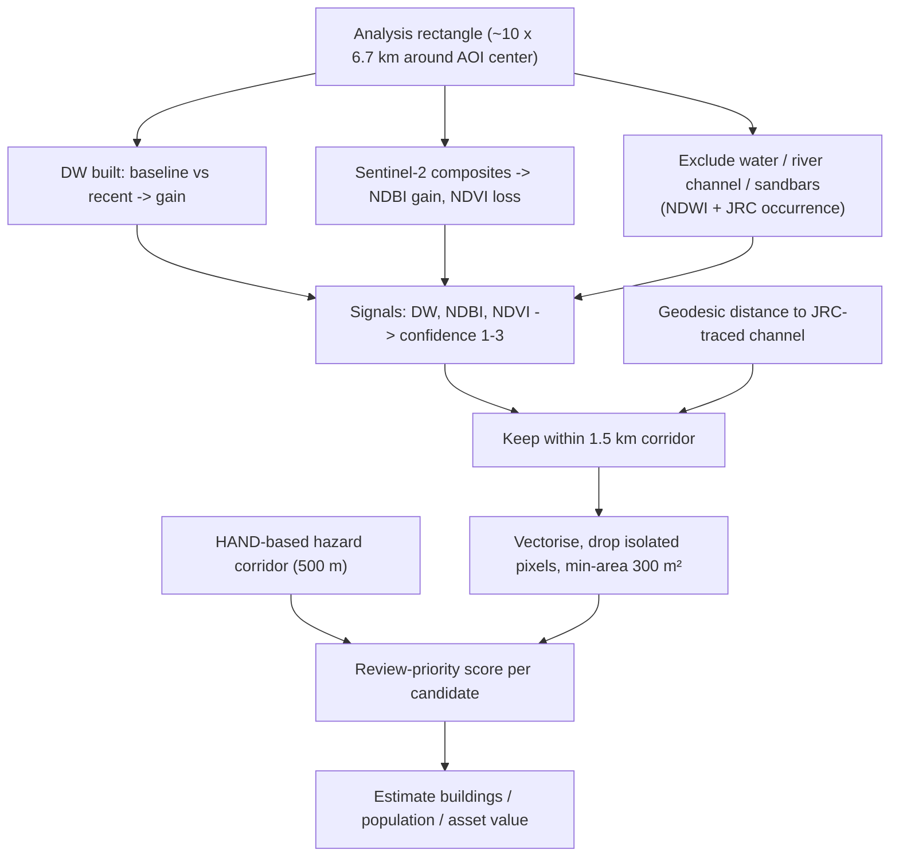

# Floodplain Development

Implemented in `backend/app/services/new_construction.py`. This feature detects
newly-built construction inside the river flood corridor by comparing a ~2016
baseline against a recent (2026) window, and ranks each candidate by a
transparent review-priority score.

> **Honesty.** 10 m imagery **cannot confirm individual buildings**. The output
> polygons are land-cover **change candidates**, and the building/population/asset
> figures are **estimates**, not a verified structure census.

## Why multi-signal (v2)

The original v1 used a single Dynamic World "built"-probability delta with tight
thresholds. Dynamic World systematically under-scores Indian semi-urban land and
scores construction-in-progress (bare earth) as "bare" rather than "built", so
genuine development fell below the cut-offs. v2 combines three independent,
complementary signals so spectral evidence Dynamic World misses is still captured.

## Signals

| Signal | Source | Meaning |
|---|---|---|
| Dynamic World built-probability increase | `GOOGLE/DYNAMICWORLD/V1` (10 m) | New settlement |
| NDBI increase | Sentinel-2 (10 m) | New hard surfaces |
| NDVI decrease | Sentinel-2 (10 m) | Vegetation cleared for construction |

Candidates are classified by how many signals agree — a transparent confidence
level (1–3), **not** a calibrated probability.

## Pipeline



Water, the permanent/seasonal river channel and river sandbars are excluded so
water-level changes and bars are not mistaken for building.

## Detection thresholds (exposed for calibration)

| Threshold | Default | Meaning |
|---|---|---|
| `dw_delta` | 0.12 | Min rise in DW built probability |
| `dw_floor` | 0.30 | Min recent built prob for the DW signal |
| `ndbi_delta` | 0.04 | Min rise in built-up index |
| `ndvi_drop` | 0.12 | Min fall in vegetation index |
| `spectral_dw_floor` | 0.15 | Weak DW presence required for a spectral-only hit |

The `/api/new-construction` endpoint accepts `dw_delta`, `ndbi_delta`,
`ndvi_drop` overrides for a live, uncached calibration pass used by the
diagnostics panel.

## Review-priority score

A transparent 0–1 score ranks which candidates a human should inspect first.
It is a **review priority, not a probability of flooding.**

```
priority = 0.40*hazard_overlap + 0.25*river_proximity
         + 0.25*confidence + 0.10*change_area
```

| Component | Normalisation |
|---|---|
| hazard_overlap | 1 if inside the modelled flood-hazard corridor, else 0 |
| river_proximity | full at/within 500 m of the channel, linear to 0 |
| confidence | signal agreement (1–3) mapped to 0–1 |
| change_area | full at a 1 ha change |

Levels: `high` ≥ 0.60, `review` ≥ 0.35, `lower` < 0.35.

## From polygons to estimates

The retained change area is converted to indicative figures:

- Footprint area = change area × `BUILT_FOOTPRINT_FRACTION` (0.45)
- New buildings = footprint area / `AVG_FOOTPRINT_M2` (70 m²)
- Population at risk = new buildings × `HOUSEHOLD_SIZE` (5)
- Asset value = footprint area × `COST_PER_M2_INR` (₹15,000)
- Expected damage = asset value × `REPRESENTATIVE_DAMAGE_FACTOR` (0.40)

The response also includes a per-stage area breakdown (DW signal, spectral,
combined candidates, within corridor, retained) so the funnel is transparent.

## Disclaimer (as returned by the API)

> Change inferred from Sentinel-2 spectral change (NDBI/NDVI) and Dynamic World
> built-probability (2016 vs 2026). 10 m imagery cannot confirm individual
> buildings — polygons are land-cover change candidates and counts are estimates.
> Validate before use.

Results are cached in Firestore (`pilots/{id}/cache/new_construction`) and rolled
up nationwide by `/api/impact`.
