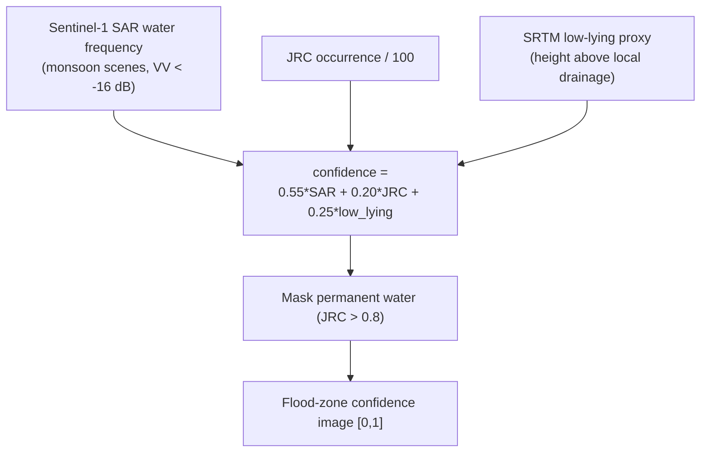
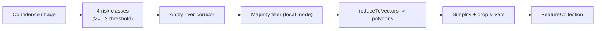

# Geospatial and Satellite Data

All geospatial computation runs server-side in Google Earth Engine (EE). There is
no local GIS stack. This page documents which EE datasets are used and how they
are combined. Earth Engine is initialised once per instance in
`backend/app/ee_client.py` using the configured GCP project.

## Datasets used

| Dataset | EE ID | Role |
|---|---|---|
| Sentinel-1 SAR GRD | `COPERNICUS/S1_GRD` | Observed flood frequency; validation water extent |
| JRC Global Surface Water v1.4 | `JRC/GSW1_4/GlobalSurfaceWater` | Seasonal/permanent water, river channel |
| SRTM 30 m DEM | `USGS/SRTMGL1_003` | Height-above-drainage, river corridor |
| Sentinel-2 Harmonized | `COPERNICUS/S2_HARMONIZED` | Before/after imagery; NDBI/NDVI change |
| Dynamic World | `GOOGLE/DYNAMICWORLD/V1` | Built-up probability change |
| GHSL built-up surface | `JRC/GHSL/P2023A/GHS_BUILT_S` | Building area exposed |
| WorldPop population | `WorldPop/GP/100m/pop` | Population exposed |
| ESA WorldCover v200 | `ESA/WorldCover/v200` | Cropland extent (class 40) |

> Dataset IDs above are copied directly from the service code. Temporal windows
> used in code: SAR flood frequency 2019–2024 (monsoon months Jun–Oct); JRC
> 1984–2021; SRTM 2000 survey; GHSL 2020; Sentinel-2 imagery windows
> ~Nov 2015–Jun 2016 (baseline) and Jan–May 2026 (recent).

## Flood-prone zone confidence

Implemented in `backend/app/services/flood_zones.py`. Three independent signals
are blended; confidence is their weighted agreement, with permanent water masked
out so zones represent floodable land.

### Water classification

A Sentinel-1 VV backscatter value below **−16 dB** (after a 50 m focal-median
speckle reduction) is classified as water. Flood frequency is the mean of these
boolean water masks across the monsoon scenes.

### River corridor (elevation-aware)

`_river_corridor` constrains zones to floodable land beside the channel. A pixel
is in the corridor when it is both within a buffer distance of the JRC-traced
channel **and** no more than a height threshold above the local river level
(a HAND-style height). This widens across flat low ground and pinches where banks
rise, instead of a flat buffer.

## Vectorisation to GeoJSON

`compute_flood_zones_geojson` buckets confidence into four risk classes, applies
the river corridor, runs a majority filter to merge neighbouring cells, vectorises
to polygons, simplifies hard pixel staircases, and drops slivers below ~0.08 km².
The result is the `ZonesGeoJSON` served by `/api/zones` and cached in Firestore.

## Damage & exposure

`backend/app/services/damage.py` intersects the flood mask (confidence ≥ 0.3)
with GHSL built-up surface and WorldPop population, then applies published
depth-damage factors across three return-period scenarios:

| Scenario | Depth | Damage factor | Return period |
|---|---|---|---|
| 1-in-10 | 1.0 m | 0.20 | 10 years |
| 1-in-25 | 2.0 m | 0.40 | 25 years |
| 1-in-100 | 3.5 m | 0.65 | 100 years |

Monetary damage uses a configurable replacement cost (₹15,000/m²) and a typical
footprint (70 m²) to convert built area to a building count. All outputs carry a
disclaimer that they are transparent estimates, not guarantees.

## Honesty notes

- SAR has cloud/timing gaps; the terrain proxy fills floodable land the SAR may
  miss, but the combined score remains a model, not an observation of today.
- The southwest monsoon window (Jun–Oct) only partly covers the Tamil Nadu /
  south-coast northeast monsoon (Oct–Dec), so some coastal-south areas are
  `modelled`.
- Imagery and change-detection use 10 m imagery that **cannot** confirm
  individual buildings; polygons are land-cover change candidates.

See [Data sources and provenance](data-sources-and-provenance.md) for the
provenance surfaced in API responses.
