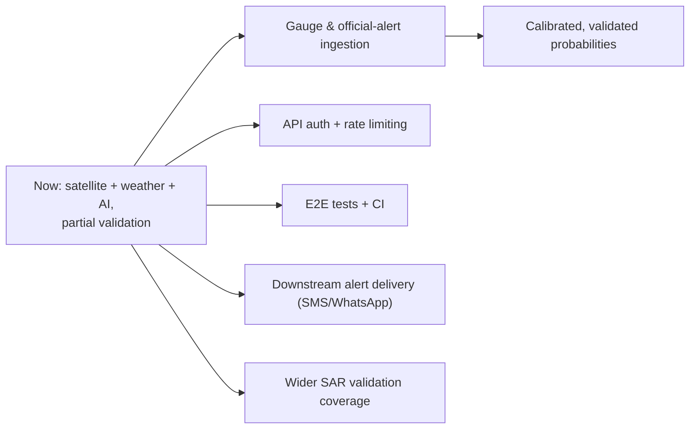

# Limitations and Roadmap

Honesty about limitations is a core design principle of ResQ Bharat. This page
collects what the system is **not**, and reasonable directions for future work.
Nothing here should be read as a committed delivery date.

## Capability status at a glance

| Capability | Status |
|---|---|
| Flood-prone zone mapping (SAR + JRC + terrain) | **Implemented** |
| SAR validation (precision / recall / IoU) | **Implemented**, reproducible via `/api/validate` |
| Live rainfall-driven risk score | **Implemented** (transparent heuristic, not calibrated probability) |
| 7-day forecast outlook | **Implemented** (derived from Open-Meteo) |
| Floodplain construction change detection | **Implemented** (multi-signal; needs field verification) |
| Crop-loss estimation | **Implemented** (satellite extent × economic assumptions) |
| Damage / exposure estimates | **Implemented** (depth-damage assumptions) |
| Before/after imagery | **Implemented** (pre-rendered to Cloud Storage) |
| Multilingual Gemini assistance, SITREP, photo check | **Implemented** (requires API key) |
| Pub/Sub alert dispatch | **Best-effort** (simulated receipt on failure) |
| Downstream SMS/WhatsApp delivery | **Not implemented** (topic consumer is external/planned) |
| Live river-gauge integration | **Not implemented** |
| Official alert / evacuation feeds | **Not implemented** |
| API authentication / rate limiting | **Not implemented** |
| Automated E2E / CI test suite | **Not implemented** |

## Key limitations

- **The risk score is a heuristic**, not a validated probability or an official
  forecast. Its weights and saturation points are reasoned engineering choices.
- **Coverage tiers matter**: only a subset of areas have real SAR validation;
  others are *modelled* or *partial* and should be read with lower confidence.
- **Static layers are dataset epochs**, not observations of today. Only rainfall is
  live.
- **Economic figures are assumptions** (replacement cost, yields, prices, cropping
  mix) — directional, not accounting-grade.
- **Change detection flags candidates**, not confirmed illegal construction; always
  verify on the ground.
- **No gauge/official data**: the system cannot confirm that flooding is happening
  right now or issue authoritative warnings.
- **Generative text is decision support**, not authority, even with grounding and
  guardrails.

## Roadmap directions

Potential next steps, roughly in priority order:

1. **Trust & safety**: add API authentication, rate limiting, and a security review
   before any operational use.
2. **Ground truth**: integrate official river-gauge and warning feeds to
   corroborate the modelled risk.
3. **Calibration**: convert the heuristic score into a statistically calibrated,
   validated probability where data supports it.
4. **Coverage**: extend real SAR validation to more areas and upgrade *modelled*
   tiers to *validated*.
5. **Delivery**: implement a Pub/Sub consumer for real alert dispatch.
6. **Quality**: add automated API and browser tests plus a CI pipeline.

> AI generated analysis — please validate against the source before relying on any
> status above.
