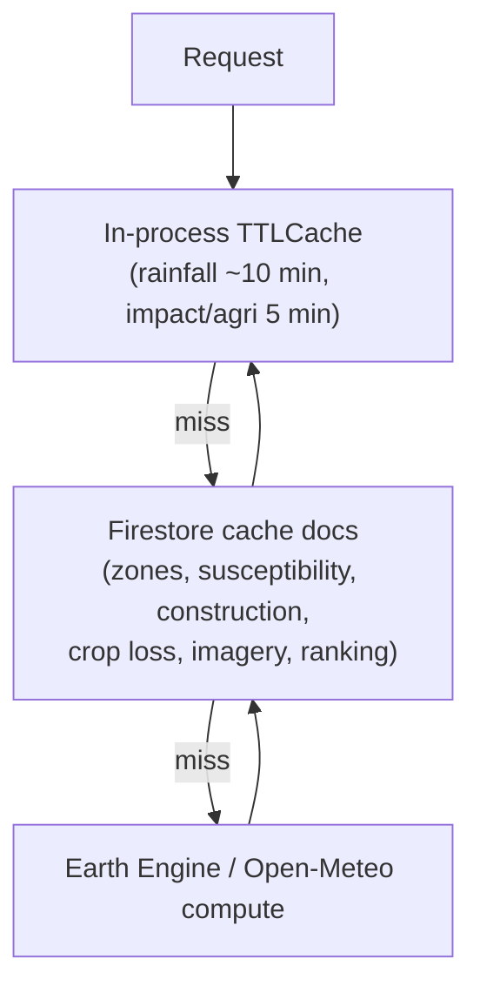
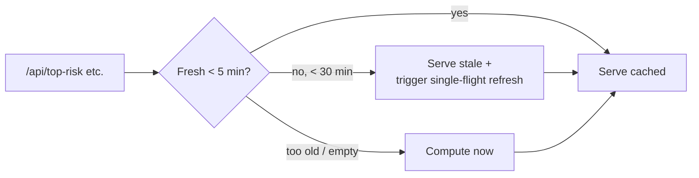

# Performance and Reliability

The backend is stateless and delegates heavy computation to Earth Engine. To keep
the UI responsive and resilient, it uses layered caching, parallelism, and
graceful degradation.

## Caching layers

- **In-process `TTLCache`** memoizes rainfall fetches (~10 min) and the nationwide
  impact/crop-loss rollups (~5 min) within a single instance.
- **Firestore** stores durable, expensive outputs (zones, susceptibility,
  construction, crop loss, imagery, ranking) so they survive instance restarts.
- **Cloud Storage** holds pre-rendered imagery PNGs served directly to the browser.

## Ranking: stale-while-revalidate

The nationwide ranking powers Top Risk, Alerts, Impact and the AI situation
report. Recomputing it assesses up to 100 areas, so it is cached and refreshed in
the background:

A single-flight lock ensures only one refresh runs at a time; other callers get
the last good result immediately.

## Parallelism

- `rank_live_risk` scores areas with a `ThreadPoolExecutor` (12 workers).
- Rollups (`impact`, `agri-loss-summary`) read many Firestore docs in parallel
  (up to 16 workers) and are **cache-only** — they never trigger live compute.
- Rainfall fetches retry up to 3 times with backoff.

## Graceful degradation

| Failure | Behaviour |
|---|---|
| One area fails during ranking | Skipped (not zeroed); `assessed < total` reflects partial data |
| Partial rainfall (missing days) | Still scored; `data_quality` flags completeness |
| Pub/Sub unavailable | Alert still generated + stored; simulated receipt returned |
| Imagery render fails | `available: false`, `url: null` (honest, no placeholder) |
| Earth Engine init fails at startup | Logged, non-fatal; `/health` stays up |
| Gemini model unavailable | Falls back through the model chain |

This "partial results over no results" philosophy means dashboards stay useful
even when some upstream calls fail — with the gaps made explicit.

## Frontend performance

- **Route-level code splitting**: only the home route is in the main bundle; other
  pages load on demand.
- **In-flight GET de-duplication** in `api.ts` collapses concurrent identical
  requests; a 30 s default timeout (60 s for situation/photo) via `AbortController`.
- Hashed assets are served with immutable cache headers from Firebase Hosting.

## Reliability notes

Response latency depends on Earth Engine and Open-Meteo, which are external and
variable. Cached endpoints return in well under a second; live compute endpoints
(`zones`, `new-construction`, `agri-loss`, `imagery` on refresh) can take several
seconds to tens of seconds. No formal SLA or uptime figure is claimed here; see
[Limitations and roadmap](limitations-and-roadmap.md).
