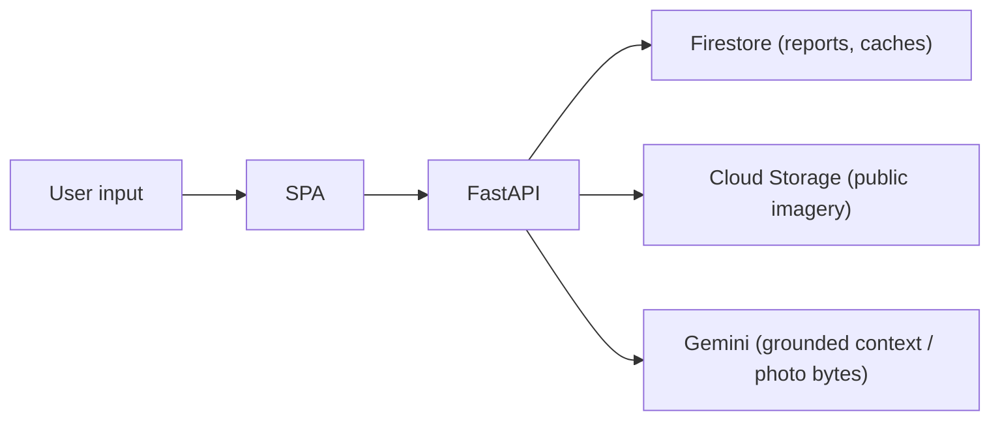

# Security and Privacy

This page describes how the system handles secrets, user data, and untrusted
input, based on the code in this repository. It documents what is implemented and
flags what is **not** guaranteed.

## Secrets

- The only application secret is `GEMINI_API_KEY`, read from the environment/`.env`
  via `config.py`. It is **never logged** and **never returned** in any response.
- On Cloud Run, Earth Engine, Firestore, Cloud Storage and Pub/Sub authenticate
  via the **attached service account** (Application Default Credentials), not an
  embedded key.
- `.env` files must not be committed. Provide secrets via a secret manager or the
  platform's environment configuration.

## Input validation

- **Citizen reports** (`POST /api/reports`) use Pydantic field constraints
  (length-bounded `location`, `hazard_type`, `severity`, `description`,
  `reporter_name`, `contact`).
- **Photo upload** (`POST /api/ai/photo`) validates MIME type
  (`image/jpeg|png|webp|heic` → 415 otherwise), rejects empty bodies (400), and
  caps size at 8 MB (413) **before** calling Gemini.
- **Unknown pilots** return 404 with the list of valid ids rather than leaking
  internal state.

## AI safety and grounding

Generative outputs are a controlled surface:

- Gemini only receives **backend-computed numbers**; prompts forbid inventing live
  measurements, gauge readings, alerts, evacuation orders, facility names/
  capacities, road conditions, distances, or phone numbers.
- Only well-known official Indian emergency numbers may be cited (112, 100, 101,
  102/108, 1070, 1077, 1091, 1098).
- The assistant never advises moving through floodwater and never claims rescue
  was dispatched or a location shared.

These rules reduce the risk of harmful or misleading generated content, but
generated text should still be treated as decision support, not authority.

## Data exposure

- **Citizen reports** may contain a name and contact the user chooses to provide;
  they are stored in Firestore. Do not enter sensitive personal data you do not
  want stored.
- **Uploaded photos** are sent to Gemini for assessment; the endpoint does not
  persist the image bytes in the code shown, but treat uploads as processed by a
  third-party model.
- **Pre-rendered imagery** in Cloud Storage is **public-read** by design (so the
  browser can load it). It contains only satellite composites, no user data.

## CORS

Allowed origins are explicit (`CORS_ORIGINS`). Keep production restricted to the
Hosting origin plus any intended clients.

## What is not guaranteed

This documentation does **not** claim: authentication/authorization on the API
(the read endpoints are public), rate limiting, encryption-at-rest configuration
beyond Google Cloud defaults, formal PII handling/retention policies, or a
completed security audit. Treat the deployment as a demonstration system and add
these controls before any production or emergency use. See
[Limitations and roadmap](limitations-and-roadmap.md).

## Reporting

If you find a security issue, do not file it with sensitive details in a public
tracker. Contact the repository owner directly.
