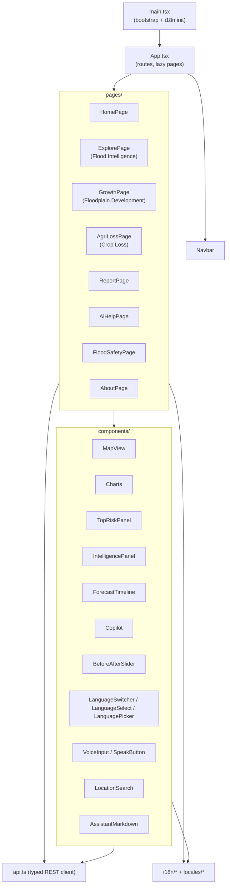
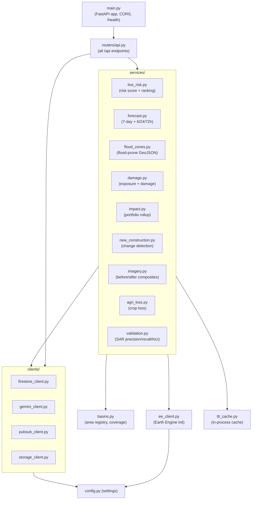

# System Components

This page maps the codebase to its runtime components. Paths are relative to the
repository root.

## Frontend (`frontend/src`)

The SPA is React 18 + Vite 5 + TypeScript, styled with Tailwind, using MapLibre
(via `react-map-gl`) for maps and Recharts for charts. Routing is `react-router-dom`
with route-level code splitting (only the landing page is in the main bundle).

### Frontend component architecture

Notable frontend modules:

- `api.ts` — typed wrappers over every endpoint, 30s default timeout (60s for AI
  situation and photo), AbortController cancellation, and in-flight GET
  de-duplication so panels asking for the same data share one request.
- `types.ts` — TypeScript shapes mirroring every API payload.
- `i18n/` — i18next init (`config.ts`), the language registry (`languages.ts`),
  runtime speech/voice capability detection (`capabilities.ts`), language
  detection (`detect.ts`), and React providers (`LanguageProvider.tsx`,
  `TtsProvider.tsx`).
- `hooks/` — `useSpeechRecognition`, `useSpeechSynthesis`, `useResponseLanguage`.

## Backend (`backend/app`)

FastAPI application. Entrypoint `main.py` builds the app, adds CORS, mounts the
router under `/api`, initialises Earth Engine on startup (non-fatal if it fails),
and exposes `/health`.

### Backend / service architecture

### Services

| Service | Responsibility | Key external data |
|---|---|---|
| `live_risk.py` | Live 0–1 risk score; cross-area ranking | Open-Meteo, EE susceptibility |
| `forecast.py` | 7-day daily outlook + 6h/24h/72h horizons | Open-Meteo (daily + hourly) |
| `flood_zones.py` | Flood-prone zone image & GeoJSON | Sentinel-1 SAR, JRC GSW, SRTM |
| `damage.py` | Buildings/population exposed + damage scenarios | GHSL built-up, WorldPop |
| `impact.py` | Nationwide exposure rollup (cache-only) | Firestore caches |
| `new_construction.py` | Multi-signal construction change detection | Sentinel-2, Dynamic World |
| `imagery.py` | Before/after true-colour composites → Cloud Storage | Sentinel-2 Harmonized |
| `agri_loss.py` | Crop-loss estimate + portfolio rollup | ESA WorldCover + assumptions |
| `validation.py` | Predicted vs observed flood extent metrics | Sentinel-1 SAR |

### Clients

| Client | Wraps | Notes |
|---|---|---|
| `firestore_client.py` | `google-cloud-firestore` | `set_doc`, `get_doc`, parallel `get_docs`, `add_doc`, `query_collection` |
| `gemini_client.py` | `google-genai` | Text + multimodal; model fallback chain; strict grounding prompts |
| `pubsub_client.py` | `google-cloud-pubsub` (lazy) | Best-effort publish; simulated receipt on failure |
| `storage_client.py` | `google-cloud-storage` | Uploads pre-rendered PNGs; returns stable public URLs |

### Supporting modules

- `basins.py` — the 100-area registry (`PILOTS`), per-area region/basin mapping,
  coverage tiers (`live`/`modelled`/`partial`), and real SAR `VALIDATION_METRICS`.
- `ee_client.py` — idempotent Earth Engine init using the configured GCP project.
- `ttl_cache.py` — thread-safe in-process TTL cache (`get`/`set`/`get_or_set`).
- `config.py` — `pydantic-settings` reading environment / `.env`.

## Scripts and tests

- `backend/scripts/` — one-off cache-warming sweeps (imagery, agri-loss) and a
  latency probe. `backend/scripts/validation_sweep.py` runs SAR validation.
- `backend/tests/` — offline unit tests (`test_registry.py`, `test_languages.py`,
  and others) run with `python -m tests.<name>` (pytest is not required).

See [Testing and validation](testing-and-validation.md) for details.
