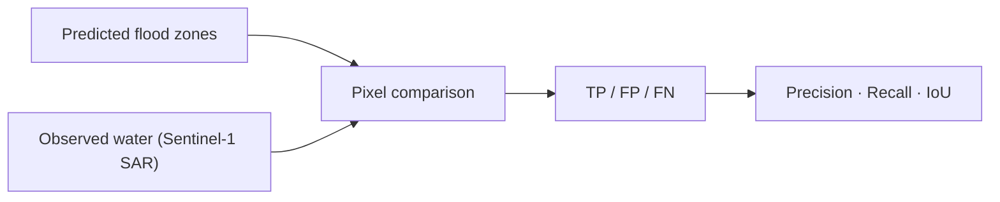

# Testing and Validation

The project has two complementary quality mechanisms: **offline unit tests** for
pure logic, and **scientific validation** of flood predictions against observed
satellite flooding.

## Offline unit tests

Located in `backend/tests/`. They exercise pure helpers and registries that do not
require Earth Engine or network access.

| Test module | Covers |
|---|---|
| `tests/test_registry.py` | Area registry, coverage tiers, region/basin lookups |
| `tests/test_languages.py` | Language registry / normalisation |

Run from the `backend` directory:

```powershell
cd backend
.\.venv\Scripts\python.exe -m tests.test_registry
.\.venv\Scripts\python.exe -m tests.test_languages
```

> These are self-contained scripts invoked as modules. They validate logic that
> can be checked without cloud credentials. Services that call Earth Engine are
> structured so their numeric helpers (e.g. crop-loss math) are separable and
> unit-testable.

## Scientific validation (SAR)

The core flood-zone predictions are validated against **observed** flooding from
Sentinel-1 radar during documented flood events.



- Documented events are listed by `GET /api/events`.
- `GET /api/validate?pilot=<id>&event=<id>` recomputes precision, recall and IoU
  live, so results are **reproducible**, not hard-coded claims.
- Validated areas carry stored `validation` metrics in the area registry
  (`VALIDATION_METRICS` in `basins.py`) and are shown with a "validated" coverage
  badge in the UI.

### Validation sweep

`backend/scripts/validation_sweep.py` runs validation across areas/events to
produce an aggregate view of predictive skill.

## Interpreting metrics honestly

- **Precision** — of the pixels we flagged as flood-prone, how many actually
  flooded.
- **Recall** — of the pixels that actually flooded, how many we flagged.
- **IoU** — overlap between predicted and observed flood extents.

These describe **static flood-zone delineation** against past events. They do
**not** validate the live rainfall-driven risk score as a calibrated probability
or a forecast. The risk score remains a transparent heuristic (see
[Flood-risk methodology](flood-risk-methodology.md)).

## What is not tested here

There is no automated end-to-end UI test suite or CI pipeline documented in this
repository. Before production use, add integration tests for the API endpoints and
a browser test for critical UI flows. See
[Limitations and roadmap](limitations-and-roadmap.md).

> Only the checks described above are asserted. Do not interpret the presence of
> this page as evidence that a given test currently passes in your environment —
> run the commands to confirm.
