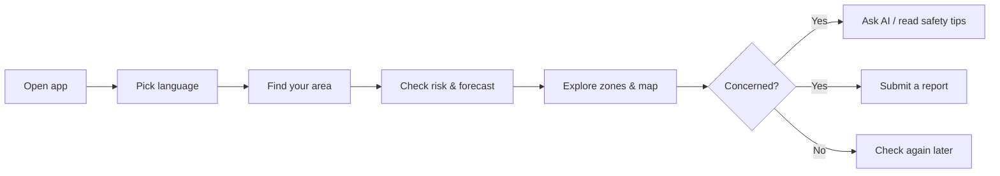

# User Guide

Welcome to **ResQ Bharat** — an India-wide flood intelligence companion. This guide
helps citizens, volunteers, and local responders use the app effectively. It
assumes no technical background.

> ResQ Bharat is a decision-support tool. It does **not** replace official
> warnings from government agencies. In an emergency, call **112** and follow
> local authorities.

## Start here

| Guide | What you'll learn |
|---|---|
| [Getting started](getting-started.md) | Open the app, pick a language, find your area |
| [Home dashboard](home-dashboard.md) | Read the main risk overview at a glance |
| [Flood intelligence](flood-intelligence.md) | Risk score, forecast, zones, alerts |
| [Map & location navigation](location-and-map-navigation.md) | Search places and read the map |
| [Floodplain development](floodplain-development.md) | New construction near rivers |
| [Agriculture & crop loss](agriculture-crop-loss.md) | Estimated farm impact |
| [Reports & response](reports-and-response.md) | Submit a hazard report |
| [Gemini AI help](gemini-ai-help.md) | Ask questions, get briefings and SITREPs |
| [Multilingual & voice](multilingual-and-voice.md) | Use your language and speech |
| [Flood safety](flood-safety.md) | Before, during, after a flood |
| [Methodology & data quality](methodology-and-data-quality.md) | How numbers are made |
| [Troubleshooting](troubleshooting.md) | Fix common problems |
| [FAQ](frequently-asked-questions.md) | Quick answers |

## Your typical journey

## Important reminders

- Numbers are **estimates and model outputs**, not official measurements.
- A "low" score does not guarantee safety; local conditions change fast.
- Always trust official evacuation orders over anything shown here.

See the [FAQ](frequently-asked-questions.md) if you're unsure what something means.
