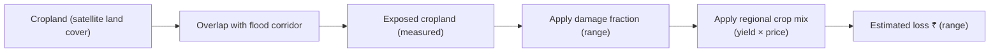

# Agriculture and Crop Loss

This view estimates how much cropland in an area could be affected by flooding and
puts an **indicative** monetary figure on it.

## What it shows

- **Exposed cropland** — area of farmland that overlaps the flood corridor
  (measured from satellite land cover).
- **Estimated damaged cropland** — a portion of the exposed area, with a range.
- **Estimated loss** — a rupee figure (and crore equivalent), with a range.
- **Per-crop breakdown** — contribution of the main crops grown in that region.
- **Severity** — a simple band reflecting how large the impact is.

## How it's calculated

The **exposed area is measured**; the **loss is estimated** using documented
assumptions about damage fraction, regional cropping mix, yields, and prices.

## Reading the numbers honestly

- The rupee figure is a **planning estimate**, not an insurance or accounting
  valuation.
- Ranges are given because the inputs are uncertain — prefer the range over a single
  number.
- The regional crop mix is an **assumption** per state/UT, not a field-verified crop
  map.
- A disclaimer is shown with the result; please read it.

## Who it helps

- **Local administrators** sizing relief or prioritising inspections.
- **Volunteers and NGOs** understanding where agricultural impact may concentrate.

Pair this with [flood intelligence](flood-intelligence.md) and the
[map](location-and-map-navigation.md) for context. For the full method, see the
technical page [Agriculture crop-loss](../technical/agriculture-crop-loss.md).

Next: [Reports & response](reports-and-response.md).
