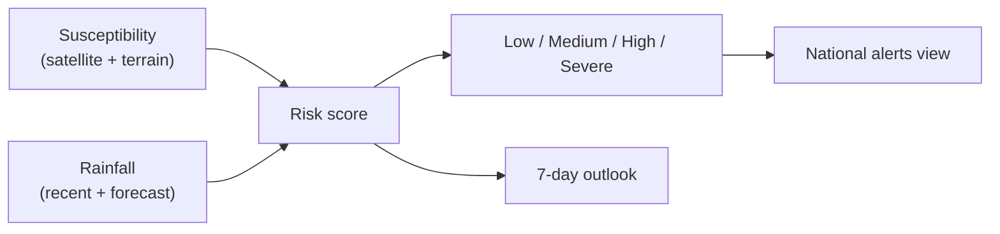

# Flood Intelligence

This section explains the core flood features: the risk score, the forecast, flood
zones, and alerts.

## Risk score

The risk score blends two things:

- **Susceptibility** — how flood-prone the land is (from satellite flood history,
  surface water, and terrain). This changes slowly.
- **Rainfall pressure** — recent rain (last 3 days) plus forecast rain (next 7
  days). This changes daily.

Rainfall pressure is weighted more heavily than susceptibility, because an area can
be flood-prone yet dry — it's the rain that triggers flooding. The result maps to
**Low / Medium / High / Severe**.

> The score is a **transparent estimate**, not a calibrated probability or an
> official forecast. See [Methodology & data quality](methodology-and-data-quality.md).

## Forecast

The forecast shows a 7-day daily outlook plus short-term horizons (next 6, 24, and
72 hours), a peak-rainfall window, and whether conditions are trending up or down.
Use it to anticipate — not to confirm — flooding.

## Flood zones

Flood zones are shaded areas on the map showing where flooding is most likely,
split into risk classes. They are built from observed satellite flood frequency,
seasonal surface water, and low-lying terrain near river corridors — and permanent
water bodies are removed so rivers themselves aren't flagged as "risk."

Where available, these zones have been **validated** against real past floods using
radar satellite imagery (see the coverage badge).

## Alerts

The app highlights areas currently at **High** or **Severe** risk nationwide, so you
can see where attention is concentrated.

## Data quality

Each risk reading reports whether its rainfall data was complete (all expected days
available). If some days are missing, the score is still shown but flagged — treat
incomplete readings with extra caution.

## What it cannot do

- It cannot confirm flooding is happening **right now** (no live gauges).
- It cannot issue an official warning or evacuation order.
- A low score is not a safety guarantee.

Next: [Map & location navigation](location-and-map-navigation.md).
