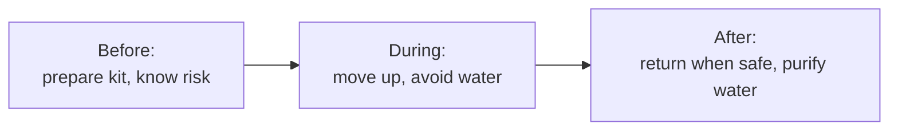

# Flood Safety

General flood-safety guidance. This is educational and does **not** replace official
instructions. In an emergency, call **112** and follow local authorities.

> Never walk, swim, or drive through floodwater. Just 15 cm of moving water can
> knock you off your feet, and 60 cm can float a car.

## Before a flood

- Know your area's risk — check the [home dashboard](home-dashboard.md) and
  [forecast](flood-intelligence.md).
- Keep an emergency kit: drinking water, food, torch, power bank, basic medicines,
  important documents in a waterproof bag.
- Identify higher ground and the safest route to it.
- Save emergency numbers (below). Charge your phone when a risk period approaches.

## During a flood

- Move to higher ground early; don't wait for water to rise.
- Avoid floodwater — it may be contaminated, electrically charged, or hiding hazards.
- Switch off electricity at the mains if it's safe to do so.
- Don't cross flooded bridges or roads.
- Follow official evacuation orders immediately.

## After a flood

- Return home only when authorities say it's safe.
- Avoid standing water and damaged electrical systems.
- Boil or purify water before drinking.
- Document damage (photos) for relief/insurance, from a safe position.

## Emergency numbers (India)

| Number | Service |
|---|---|
| **112** | All-in-one emergency |
| **100** | Police |
| **101** | Fire |
| **102 / 108** | Ambulance |
| **1070** | State disaster control |
| **1077** | District disaster control |
| **1091** | Women's helpline |
| **1098** | Child helpline |

These are well-known national/state helplines. The app will never invent other
numbers — if you see an unfamiliar number elsewhere, verify it.

## Using ResQ Bharat safely

- Use the app to **anticipate and understand** risk, not to confirm it's safe to
  travel through water.
- A "Low" reading is **not** a guarantee — local conditions can change quickly.
- The [AI assistant](gemini-ai-help.md) can answer safety questions in your language.

Next: [Methodology & data quality](methodology-and-data-quality.md).
