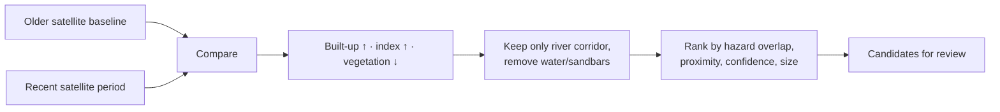

# Floodplain Development

The floodplain view highlights **new construction near rivers** — places where
building appears to have happened inside flood-prone corridors. This supports
awareness and planning; it is **not** a legal determination.

## What it shows

- **Construction candidates** — marked areas where multiple satellite signals agree
  that new built-up land has appeared close to a river.
- **Priority** — a ranking (higher / review / lower) that combines how much the
  change overlaps the hazard zone, how close it is to the river, detection
  confidence, and the size of the change.
- **Estimates** — indicative figures such as affected footprint, households, and
  potential cost at risk.

## How change is detected

The system compares an older satellite baseline with a recent period and looks for
three agreeing signs of new building:

- a rise in built-up land probability,
- an increase in a "built surface" index, and
- a loss of vegetation.

It focuses on a corridor near the river and deliberately **excludes** water,
channels, and sandbars so natural features aren't mistaken for construction.

## How to use it responsibly

- These are **candidates for review**, not confirmed illegal construction.
- Always verify on the ground before drawing conclusions or taking action.
- Estimated households and costs are **indicative assumptions**, not a survey.
- Detection can miss changes or flag false positives depending on cloud cover and
  season.

## For planners and volunteers

Use the priority ranking to decide where a field visit is most worthwhile. Pair it
with the [map](location-and-map-navigation.md) and
[flood zones](flood-intelligence.md) to understand the hazard context.

Next: [Agriculture & crop loss](agriculture-crop-loss.md).
