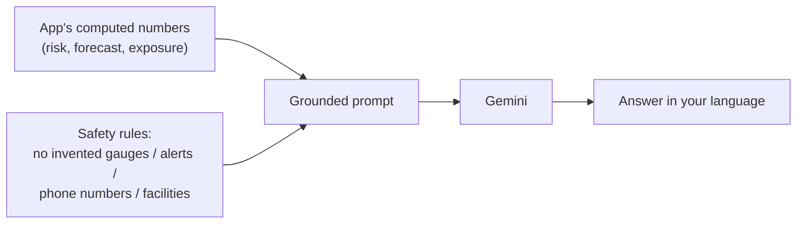

# Gemini AI Help

ResQ Bharat includes an AI assistant (powered by Google Gemini) that explains the
situation in plain language, in your language. It is grounded in the app's computed
data and follows strict safety rules.

## What it can do

- **Briefing** — a short summary of an area's current risk, forecast, and exposure.
- **Chat** — ask questions about a specific area and get answers based on its data.
- **Safety assist** — general flood-safety guidance not tied to one area.
- **Situation report (SITREP)** — a nationwide summary of where risk is highest
  right now.
- **Photo check** — upload a flood photo and get a description and basic
  observations.

## How answers stay trustworthy

The AI is given only the app's real numbers and is instructed **not** to invent live
measurements, official alerts, evacuation orders, facility names, road conditions,
or phone numbers. It may cite only well-known national emergency numbers, and it
never advises walking or driving through floodwater.

## Using it well

- Ask clear questions, e.g. "Is the risk rising this week?" or "What should I do to
  prepare?"
- Choose your language from the switcher; the AI replies in that language.
- Treat answers as **helpful guidance**, not official instructions.

## Important limits

- The assistant **cannot** confirm live flooding, dispatch rescue, share your
  location, or issue an official warning.
- Photo checks are **observations**, not expert damage assessments.
- AI features require the service to be configured with an API key; if unavailable,
  these features may not respond. See [Troubleshooting](troubleshooting.md).

Next: [Multilingual & voice](multilingual-and-voice.md).
