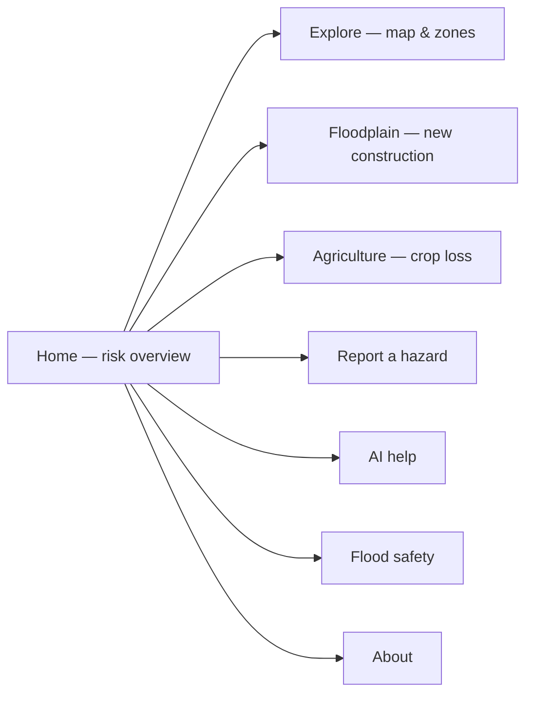

# Getting Started

This page gets you from opening ResQ Bharat to viewing your area in a few steps.

## 1. Open the app

Open ResQ Bharat in any modern browser (Chrome, Edge, Firefox, or Safari) on a
phone or computer. No installation or login is required.

## 2. Choose your language

Use the language switcher in the top navigation bar. The interface is available in
ten Indian languages: English, Hindi, Bengali, Marathi, Telugu, Tamil, Gujarati,
Kannada, Malayalam, and Punjabi. Your choice is remembered on your device.

> AI answers can be given in even more languages than the menu interface — see
> [Multilingual & voice](multilingual-and-voice.md).

## 3. Find your area

- Use the **location search** to type a place name, or
- Pick from the list of monitored study areas.

ResQ Bharat monitors **100 study areas across India** (28 states and 8 union
territories), organised by river basin.

## 4. Read the dashboard

Once an area is selected, the [home dashboard](home-dashboard.md) shows its current
flood-risk level, rainfall context, and a 7-day outlook. Explore deeper layers from
there — see [Flood intelligence](flood-intelligence.md).

## Navigating the app

Use the top navigation bar to move between these sections at any time.

## Tips

- If a panel shows "data unavailable," the system is being honest — that layer
  couldn't be computed for your area right now. See
  [Troubleshooting](troubleshooting.md).
- Coverage differs by area. Some areas are **validated** against past floods;
  others are **modelled**. Look for the coverage badge and read
  [Methodology & data quality](methodology-and-data-quality.md).

Next: [Home dashboard](home-dashboard.md).
