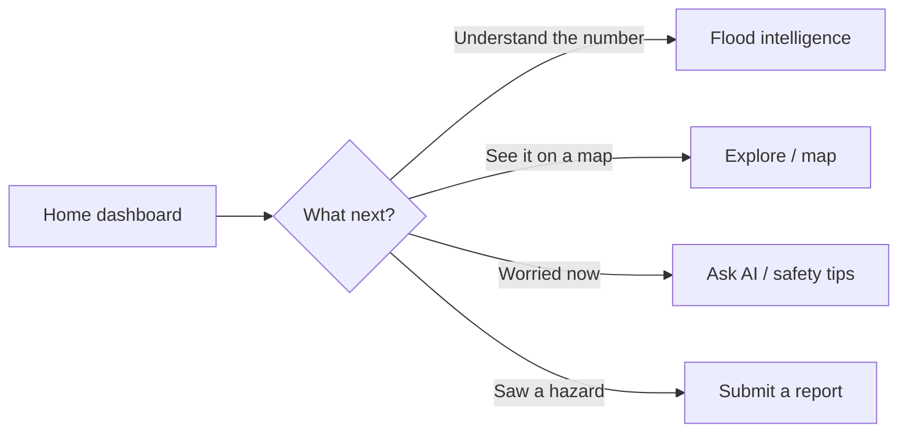

# Home Dashboard

The home dashboard is your at-a-glance flood overview for the selected area.

## What you see

- **Risk level** — a word (Low / Medium / High / Severe) and a score summarising
  current flood risk, combining the area's flood susceptibility with recent and
  forecast rainfall.
- **Rainfall context** — how much rain fell in the last three days and how much is
  forecast over the next seven.
- **Forecast outlook** — a short-term trend and peak-rainfall windows.
- **Coverage badge** — whether the area is **validated** (checked against real past
  floods), **modelled**, or **partial**.
- **Quick links** — into the map, floodplain, agriculture, reports, and AI help.

## Reading the risk level

| Level | Meaning |
|---|---|
| **Severe** | Very high combined risk — pay close attention and follow local advice |
| **High** | Elevated risk — stay alert and prepared |
| **Medium** | Moderate risk — keep an eye on conditions |
| **Low** | Lower risk — routine awareness |

## Important

- The level is a **model estimate**, not an official warning. A "Low" reading does
  **not** guarantee safety.
- The score updates as new rainfall data arrives; it is not a live river-gauge
  reading.
- If some panels are empty, that layer couldn't be computed for your area — the app
  shows gaps honestly rather than guessing.

To understand exactly how the score is built, see
[Flood intelligence](flood-intelligence.md) and
[Methodology & data quality](methodology-and-data-quality.md).
