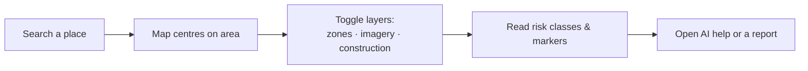

# Map and Location Navigation

The map is where ResQ Bharat's intelligence becomes visual. This page explains how
to find a place and read what you see.

## Finding a place

Use the **location search** to type a town, city, or landmark. You can also pick
directly from the list of monitored study areas. When you select an area, the map
centres on it and the dashboards update.

## Reading the map

- **Flood zones** appear as shaded polygons in different risk classes — darker or
  more intense shading means higher modelled flood likelihood.
- **Before/after imagery** lets you compare satellite views across time using a
  slider, to see change on the ground.
- **Construction candidates** (on the floodplain view) mark places where new
  building appears to have happened near the river.

## Tips for reading zones

- Zones show **where** flooding is likely, based on history and terrain — not a
  live flood map of today.
- Permanent rivers and lakes are deliberately **excluded**, so a river channel is
  not shown as "at risk."
- Coverage varies: validated areas are more trustworthy than modelled ones. Check
  the badge and [Methodology & data quality](methodology-and-data-quality.md).

## Imagery

Before/after composites are **pre-rendered** satellite images (cloud-filtered).
Some areas may show "imagery unavailable" when a clean composite couldn't be made —
that's expected honesty, not an error on your side.

## Performance note

Heavy layers (zones, construction, imagery) may take a few seconds to appear the
first time, because they are computed from satellite data. Once ready, they load
quickly.

Next: [Floodplain development](floodplain-development.md).
