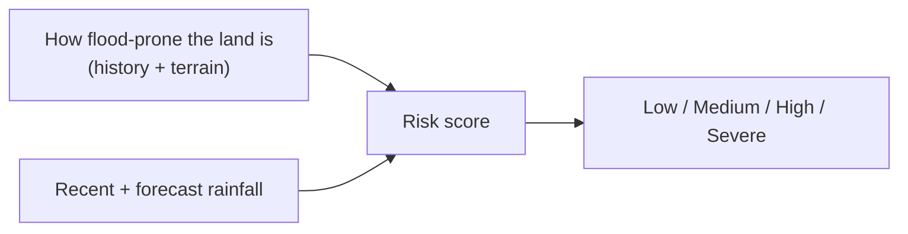

# Methodology and Data Quality

This page explains, in plain language, how ResQ Bharat produces its numbers and how
much to trust them. For the technical detail, see
[Flood-risk methodology](../technical/flood-risk-methodology.md).

## Where the data comes from

- **Rainfall** — a free weather service provides the last 3 days of observed rain
  and a 7-day forecast. This is the only part that is genuinely "live."
- **Flood history** — radar satellites record where water appeared during past
  monsoons.
- **Surface water & terrain** — global datasets show permanent/seasonal water and
  land height.
- **Land cover** — satellite maps show cropland and built-up areas.

## How the risk score is built

Rainfall carries more weight than the land's susceptibility, because rain is what
actually triggers flooding. The combined value is grouped into four levels.

> The score is a **transparent estimate**, not a calibrated probability and not an
> official forecast.

## Coverage tiers — read the badge

| Badge | Meaning | Trust |
|---|---|---|
| **Validated** | Checked against real past floods using radar satellites | Highest |
| **Modelled** | Computed from datasets, not individually validated | Moderate |
| **Partial** | Harder terrain (hills, desert, islands); limited coverage | Use with caution |

Validated areas carry accuracy metrics (precision, recall, overlap) derived from
real flood events — so you can see how well predictions matched reality.

## Data freshness

- **Live:** rainfall (fetched when you view an area).
- **Static:** flood history, terrain, surface water, land cover — these are dataset
  snapshots from their respective time periods, **not** observations of today.
- **Cached:** heavy outputs (zones, crop loss, construction, imagery) are stored and
  shown with the time they were generated.

## Honest limitations

- No live river-gauge readings — the app can't confirm flooding is happening **now**.
- No official alerts/evacuation feeds.
- Economic figures (damage, crop loss) are **assumptions** for estimation.
- A low score is not a safety guarantee.

Understanding these tiers and limits is the key to using ResQ Bharat wisely. See
[Limitations and roadmap](../technical/limitations-and-roadmap.md).

Next: [Troubleshooting](troubleshooting.md).
