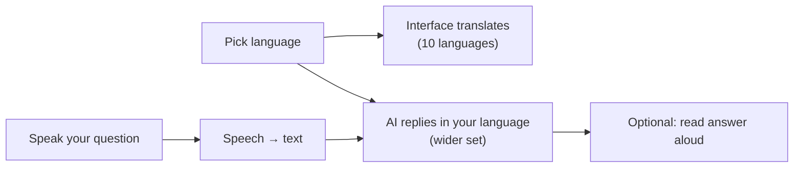

# Multilingual and Voice

ResQ Bharat is built for India's linguistic diversity. This page explains language
options and voice features.

## Interface languages

The app interface is available in **ten languages**: English, Hindi, Bengali,
Marathi, Telugu, Tamil, Gujarati, Kannada, Malayalam, and Punjabi. Switch any time
using the language control in the top bar; your choice is remembered on your device.

## AI answer languages

The AI assistant can respond in **more** languages than the interface menu offers,
including additional regional languages. When you ask a question, the answer is
produced in your selected language.

## Voice input

Where your browser and device support it, you can **speak** a question instead of
typing. The app converts speech to text and sends it to the assistant.

- Voice support depends on your **browser and device**, and is detected at runtime —
  it may not be available everywhere.
- Speak clearly; background noise reduces accuracy.

## Read aloud

The app can read certain answers aloud using your device's speech capabilities,
where supported. This helps users who prefer listening or have difficulty reading.

## Honest note on capabilities

- The interface being translated into a language does **not** automatically mean
  voice input or read-aloud works for that language — those depend on your device.
- If a voice feature is missing, the app falls back to typing and on-screen text.

## Tips

- If speech isn't working, check microphone permission in your browser.
- For best AI answers, select the language you're most comfortable reading.

Next: [Flood safety](flood-safety.md).
