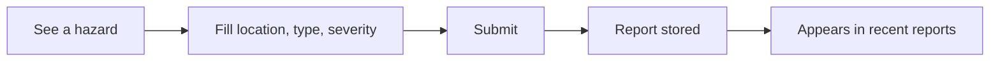

# Reports and Response

ResQ Bharat lets you **submit hazard reports** from the ground and **view recent
reports** from others. This crowd-sourced layer complements the satellite view.

> Reporting here does **not** dispatch rescue. In an emergency, call **112**.

## Submitting a report

Open the **Report** page and fill in:

- **Location** (required) — where the hazard is.
- **Hazard type** (required) — e.g. flooding, waterlogging, landslide, road
  blockage.
- **Severity** (required) — how serious it is.
- Optional: a **description**, your **name** and **contact**, and the specific area.

Submit, and the report is saved and appears in the recent-reports list.

## Privacy

- Name and contact are **optional**. Only provide them if you're comfortable; they
  are stored with the report.
- Do not enter sensitive personal information you don't want saved.
- See [Security & privacy](../technical/security-and-privacy.md) for how data is
  handled.

## Viewing reports

The recent-reports list shows the latest submissions, newest first. Use it to
understand what people on the ground are seeing, alongside the model's view.

## Good reporting practice

- Be specific about the **location** — a landmark helps responders.
- Report **what you can see**, not rumours.
- If conditions are dangerous, prioritise your safety first — see
  [Flood safety](flood-safety.md).

## Alerts

From the AI help section you can also generate a localized **citizen alert** draft
for an area. This creates alert text and records it; actual delivery to phones
depends on a separate messaging service that may not be connected. Treat generated
alert text as a draft, not a confirmed broadcast.

Next: [Gemini AI help](gemini-ai-help.md).
